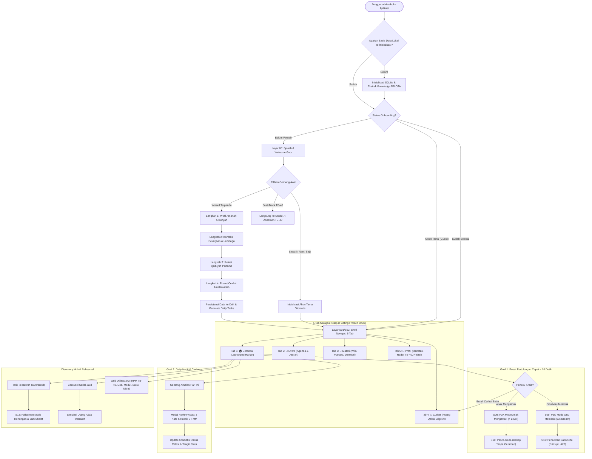
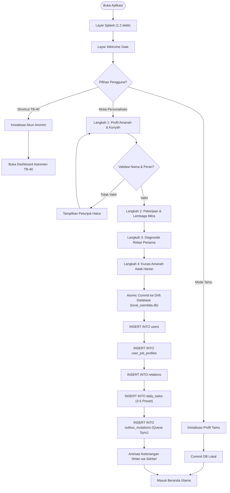
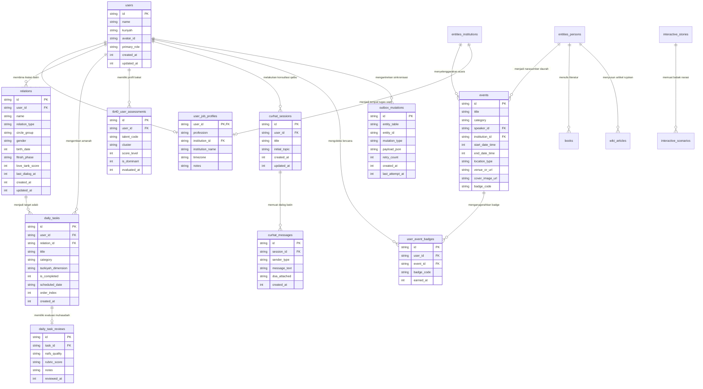
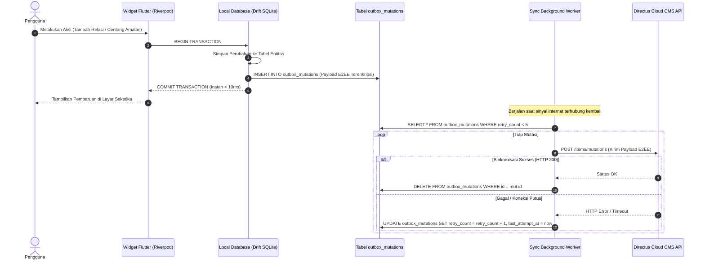

# Master Userflow & Arsitektur Aliran Data PKN Mobile App
*(Pendidikan Karakter Nabawiyah & Tazkiyatun Nafs)*

> **Status Dokumen:** Master Specification Blueprint — Userflow & Data Architecture  
> **Versi:** 2.0 (Unified Canonical Edition)  
> **Target Implementasi:** Flutter Native (Dart 3.7+ / Flutter 3.29+) pada [`/home/abuhafi/Project/pkn-mobile`](file:///home/abuhafi/Project/pkn-mobile)  
> **Basis Rujukan Desain:** Prototipe `v0` s.d. `v5`, `compile v2`, `preview-v3`, `designv2` (Figma / FigCraft), `Event v1`, `AI v1`, serta korpus `wiki-pkn`  
> **Arsitektur Persistensi:** Dual-Database Engine (*Offline-First Drift SQLite* + *LibSQL Vector OTA* + *Directus CMS Outbox*)  
> **Standar Aksesibilitas:** WCAG 2.2 AAA, Anti-Guilt UX, Non-Gamification, Calm Technology

---

## Daftar Isi
1. [Pengantar & Prinsip Dasar Pengalaman Pengguna (UX Philosophy)](#1-pengantar--prinsip-dasar-pengalaman-pengguna-ux-philosophy)
   - 1.1 Visi Produk: Pocket Calming Companion & Dual-Core Calm Technology
   - 1.2 Pilar Anti-Guilt UX & Non-Gamification
   - 1.3 Tiga Bahasa Mendidik & Pentahapan Fitrah
   - 1.4 Ergonomi Navigasi Jakob's Law & Goal-Directed Launchpad
   - 1.5 Arsitektur Data Dual-Database Luring-Daring
2. [Peta Global Userflow Aplikasi (Macro System Flowchart)](#2-peta-global-userflow-aplikasi-macro-system-flowchart)
   - 2.1 Diagram Alur Global End-to-End
   - 2.2 Matriks 5 Status Utama Aplikasi (*App Lifecycle States*)
3. [Userflow Onboarding Terpadu (Wizard 4 Langkah & Fast-Track)](#3-userflow-onboarding-terpadu-wizard-4-langkah--fast-track)
   - 3.1 Cold Start, Splash & Welcome Gate
   - 3.2 Langkah 1: Profil Amanah Diri & Kunyah
   - 3.3 Langkah 2: Konteks Aktivitas & Lembaga
   - 3.4 Langkah 3: Diagnostik Relasi Qalbiyah Pertama
   - 3.5 Langkah 4: Kurasi Amanah Adab Harian Awal
   - 3.6 Jalan Pintas Khusus: Fast-Track Asesmen Bakat TB-40
   - 3.7 Mode Tamu (*Guest Experience*) & *Progressive Profiling*
   - 3.8 Diagram Alur Onboarding Lengkap
   - 3.9 Transaksi Data & Inisialisasi Database Pasca-Onboarding
4. [Userflow Beranda (Goal-Directed Launchpad & Discovery Hub)](#4-userflow-beranda-goal-directed-launchpad--discovery-hub)
   - 4.1 Header Dinamis & Mode Renungan (*Pull-Down Gesture*)
   - 4.2 Dynamic Search Ticker Bar (Pencarian FTS5 & Vektor 384-Dim)
   - 4.3 Goal 1: Pusat Pertolongan Cepat (< 10 Detik P3K Emergency & Ruang Qalbu)
     - S08: Mode Anak Mengamuk (SOP Tantrum 4-Level)
     - S09: Mode Ortu Mau Meledak (60s Breathing & Grounding)
     - S10: Pemulihan Anak Pasca-Reda (Dekapan Tanpa Ceramah)
     - S11: Pemulihan Jiwa Orang Tua (Prinsip HALT & Tangki Cinta Ilahi)
   - 4.4 Goal 2: Amalan Adab Hari Ini (Daily Habit Loop)
     - Ceklist 3 Amalan Prioritas & Toggle Status
     - Modal Review Adab: 3 Kualitas Nafs, Rubrik BT-MM, Respons Anak
   - 4.5 Highlight Promosi Event Terdekat (Dedicated Countdown Banner)
   - 4.6 Rekomendasi Aktivitas (Horizontal Carousel: Modul, Serial Zaid, Hening Qalbu, TB-40)
   - 4.7 Grid 2x3 Instrumen & Utilitas Praktis
5. [Userflow 5 Tab Navigasi Utama (Floating Frosted Dock)](#5-userflow-5-tab-navigasi-utama-floating-frosted-dock)
   - 5.1 Tab 1 — Beranda (*Daily Launchpad*)
   - 5.2 Tab 2 — Event (*Agenda Majelis & Daurah Akbar*)
   - 5.3 Tab 3 — Materi / Wiki (*Pusat Khazanah, Pustaka & Direktori*)
   - 5.4 Tab 4 — Curhat (*Ruang Qalbu, Walkie-Talkie PTT & Generator RPP*)
   - 5.5 Tab 5 — Profil (*Identitas, Dinamika Jiwa, Relasi, Radar TB-40, Mizan Scale & E2EE*)
6. [Userflow Fitur-Fitur Lanjutan & Fitur yang Belum Sempat Dibuat](#6-userflow-fitur-fitur-lanjutan--fitur-yang-belum-sempat-dibuat)
   - 6.1 Modul 12: Cerita Interaktif & Rehearsal Simulasi Adab (Serial Zaid)
   - 6.2 Modul 7: Asesmen Mendalam Tafsir Bakat 40 (TB-40)
   - 6.3 Modul 4: Kemitraan Lembaga & Institusi Pendidikan (B2B Tarbiyah)
   - 6.4 Generator Dokumen RPP Adab 1 Lembar Standar SOTAB
   - 6.5 Konsep Game Simulasi: "Baitul Fitrah & Madinah Virtual" (AFK Tarbiyah)
   - 6.6 Multi-Device Sync & Manajemen Enkripsi E2EE Zero-Knowledge
7. [Arus Data & Relasi Entitas Lengkap (Data Flow & ERD)](#7-arus-data--relasi-entitas-lengkap-data-flow--erd)
   - 7.1 Entity Relationship Diagram (ERD) Komprehensif
   - 7.2 Kamus Data Database Lokal Personal (`local_userdata.db` - Drift SQLite)
   - 7.3 Kamus Data Database Khazanah Publik (`knowledge_v4.db` - LibSQL / OTA)
   - 7.4 Matriks Keterkaitan Data & Triger Lintas Fitur (*Cross-Feature Wire*)
   - 7.5 Aliran Sinkronisasi Outbox Mutation Pattern (Luring-ke-Daring)
8. [Matriks Titik Gesek Pengguna (*Friction Points*) & Mitigasi UX](#8-matriks-titik-gesek-pengguna-friction-points--mitigasi-ux)
9. [Kesimpulan & Panduan Transisi Implementasi Kode](#9-kesimpulan--panduan-transisi-implementasi-kode)

---

## 1. Pengantar & Prinsip Dasar Pengalaman Pengguna (UX Philosophy)

### 1.1 Visi Produk: Pocket Calming Companion & Dual-Core Calm Technology
Aplikasi **PKN Mobile** dibangun bukan sebagai platform konsumsi konten pasif yang menyita perhatian, melainkan sebagai **sahabat saku penenteram jiwa (*pocket calming companion*)** bagi orang tua, guru, santri, dan pembelajar mandiri. Aplikasi mengusung filosofi **Dual-Core Calm Technology**:
1. **Core 1 — Khazanah & Perkakas Nyata (Wiki-Tools Hub):** Menyediakan panduan darurat di lapangan dalam waktu < 10 detik, katalog literatur resmi, agenda majelis akbar, dan manajemen adab sehari-hari tanpa beban kognitif berlebih.
2. **Core 2 — Refleksi Jiwa & Pendampingan Batin (Spiritual AI & Narrative Rehearsal):** Menghadirkan teman curhat beradab tanpa penghakiman (*non-judgmental*), simulasi latihan respon emosi orang tua menghadapi krisis nyata, serta navigasi suara bakat fitrah (TB-40).

```
                      ┌────────────────────────────────────────────────────────┐
                      │            DUAL-CORE CALM ARCHITECTURE                 │
                      └───────────────────────────┬────────────────────────────┘
                                                  │
                 ┌────────────────────────────────┴────────────────────────────────┐
                 ▼                                                                 ▼
┌─────────────────────────────────┐                               ┌─────────────────────────────────┐
│     CORE 1: WIKI-TOOLS HUB      │                               │   CORE 2: SPIRITUAL AI & REHEARSAL│
│ • P3K Tantrum < 10 Detik        │                               │ • Ruang Qalbu (Curhat AI Edge)  │
│ • Daily Task Amalan Adab        │                               │ • Walkie-Talkie Voice PTT       │
│ • Khazanah 6 Pilar MOC P1–P6    │                               │ • Simulasi Serial Zaid Rehearsal│
│ • Event Daurah & Pustaka Buku   │                               │ • Dialektika Bakat TB-40        │
│ • Direktori Tokoh & Lembaga     │                               │ • Generator RPP Adab 1 Lembar   │
└─────────────────────────────────┘                               └─────────────────────────────────┘
```

---

### 1.2 Pilar Anti-Guilt UX & Non-Gamification
Mengacu pada kaidah *Tazkiyatun Nafs* syar'i, aplikasi secara tegas menolak pola desain gelap (*dark patterns*) dan gamifikasi toksik modern:
* **Anti-Streak Shaming:** Tidak ada notifikasi intimidatif ("*Kamu kehilangan streak 12 hari!*"). Jika pengguna rehat beberapa hari, aplikasi menyambut kembali dengan salam kehangatan dan doa ketenangan jiwa.
* **Anti-Leaderboard & Anti-Riya':** Tidak ada papan peringkat komparatif antar-keluarga, antar-guru, atau antar-santri yang dapat memicu ujub, riya', atau rasa rendah diri (*parenting inferiority*).
* **Rubrik Kualitatif Otentik (BT - MT - BK - MM):** Menggantikan nilai angka desimal kaku (seperti "Skor Ketaatan: 87.5%") dengan indikator fitrah kanonikal:
  * **BT (Belum Tampak):** Perilaku adab belum muncul secara konsisten.
  * **MT (Mulai Tampak):** Muncul dengan stimulasi atau pengingat santun.
  * **BK (Berkembang):** Muncul atas kesadaran mandiri di sebagian besar kesempatan.
  * **MM (Membudaya):** Telah menjadi karakter alami dan menginspirasi lingkungan sekitar.
* **Status Tangki Cinta Reflektif:** Tidak menggunakan persentase angka mati (`Zaid: 95%`). Status disajikan secara kualitatif reflektif (*"Penuh Kehangatan"*, *"Butuh Waktu Bersama"*).

---

### 1.3 Tiga Bahasa Mendidik & Pentahapan Fitrah
Seluruh konten, rekomendasi tugas harian, dan dialog batin dikalibrasi mengikuti kaidah Tiga Bahasa Mendidik dan 4 Tahap Usia Fitrah:

| Fase Usia | Rentang Usia | Bahasa Mendidik Utama | Batasan & Kaidah Syar'i Pokok |
| :--- | :---: | :--- | :--- |
| **Thufulah** | 0 – 7 Tahun | **Bahasa Hati** (*Tautan Batin & Pelukan*) | Fitrah keimanan & bermain; **Haram sanksi fisik/pukulan**; larangan mendoktrin dengan menakut-nakuti neraka; tuntaskan hak egosentris (*Tantrum Itu Indah*). |
| **Tamyiz** | 7 – 10 Tahun | **Bahasa Lisan** (*Dialog Sebab-Akibat*) | Nalar pembedaan baik-buruk; pembiasaan shalat 5 waktu secara bertahap (~5.000 kali ajakan persuasif selama 3 tahun) **tanpa pukulan fisik**. 6 filter tutur Al-Qur'an (*qaulan sadida, baligha, layyina, karima, maisura, ma'rufa*). |
| **Murahaqah** | 10 – 14 Tahun | **Bahasa Tangan Terukur** (*Ketegasan Disiplin Ta'dib*) | Pemisahan tempat tidur (*madhaji'*); batas kedisiplinan syar'i sanksi 10 tahun bagi yang meninggalkan shalat dengan batasan ketat: **dilarang keras memukul wajah**, tidak meremukkan raga/jiwa; penempaan rasa malu (*haya'*). |
| **Syabab & Baligh** | 14 – 18+ Tahun | **Dialog Persahabatan & Kemitraan** | Kematangan aqil baligh mukallaf penuh; kemandirian sosial-finansial; penjagaan kehormatan (*iffah*); penemuan misi hidup dan peran peradaban (*syakilah*). |

---

### 1.4 Ergonomi Navigasi Jakob's Law & Goal-Directed Launchpad
Berdasarkan evaluasi kritis UX dan audit OMP (*UI/UX Pro Max*):
1. **Jakob’s Law:** Pengguna menghabiskan 90% waktu digitalnya di aplikasi lain. PKN Mobile mengunci sistem navigasi pada **5 menu tetap dengan label standar industri**: `[ Beranda | Event | Materi | Curhat | Profil ]`.
2. **Distribusi Waktu 80/20:** Sekitar 85%–90% sesi harian pengguna terpusat di **Beranda**. Oleh karena itu, Beranda dirancang sebagai **Goal-Directed Launchpad** yang langsung menjawab 2 tujuan utama pengguna (Pertolongan Cepat < 10 detik & Amalan Adab Hari Ini) sebelum menyajikan area penjelajahan (*Discovery Hub*).

---

### 1.5 Arsitektur Data Dual-Database Luring-Daring
Untuk menjamin privasi mutlak dan kecepatan akses instan luring:
* **Database 1 (`local_userdata.db` via Drift SQLite):** Khusus data privat pengguna (identitas, keluarga, amalan adab, rekaman curhat, jurnal muhasabah, mutasi sinkronisasi). Data tersimpan 100% lokal di perangkat (*zero cloud leakage*).
* **Database 2 (`knowledge_v4.db` via LibSQL / SQLite Vector):** Khusus khazanah publik manhaj (agenda acara, buku, artikel wiki, dalil takhrij, skenario serial Zaid, direktori tokoh/lembaga). Dikompresi via zstandard (`.zst`) dan diperbarui secara berkala melalui mekanisme Over-The-Air (OTA) delta sync.

---

## 2. Peta Global Userflow Aplikasi (Macro System Flowchart)

### 2.1 Diagram Alur Global End-to-End



---

### 2.2 Matriks 5 Status Utama Aplikasi (*App Lifecycle States*)

| Status Aplikasi | Kondisi Pemicu | Layar Aktif | State Penyimpanan Kunci |
| :--- | :--- | :--- | :--- |
| **1. Uninitialized** | Pemasangan awal aplikasi / clear data. | Splash Screen & Loading Bar. | Ekstraksi aset `knowledge_v4.db.zst` ke direktori lokal aplikasi. |
| **2. Onboarding Gate** | `users` kosong atau `is_onboarding_completed == false`. | Wizard 4 Langkah atau Shortcut TB-40. | `OnboardingWizardState` disimpan di memori Riverpod sebelum commit final. |
| **3. Goal-Directed Launch** | Sesi normal harian pengguna aktif. | Tab 1: Beranda. | Sinkronisasi `daily_tasks` hari ini, kalkulasi status `relations`, verifikasi offline outbox. |
| **4. Crisis Emergency** | Ketukan tombol merah *"P3K SOP Tantrum < 10 Detik"* atau pemicu genting. | Bottom Sheet S08–S11 dengan latar *scrim* gelap. | State darurat tanpa interupsi, pencatatan log insiden lokal opsional. |
| **5. Deep Discovery & Rehearsal** | Penjelajahan khazanah, kajian audio, simulasi narasi, atau konsultasi Ruang Qalbu. | Tab 2, 3, 4, 5 atau Modal Layar Penuh. | State streaming LLM lokal, playback audio hands-free, mutasi progress milestone cerita. |

---

## 3. Userflow Onboarding Terpadu (Wizard 4 Langkah & Fast-Track)

Onboarding dirancang dengan mematuhi prinsip **Warmth, Non-Coercion, and Immediate Value**. Pengguna tidak dipaksa mendaftar akun berbasis email/password yang berbelit-belit.

```
┌────────────────────────────────────────────────────────────────────────┐
│                  ONBOARDING WIZARD 4 LANGKAH TERPANDU                  │
├─────────────────┬─────────────────┬─────────────────┬──────────────────┤
│    LANGKAH 1    │    LANGKAH 2    │    LANGKAH 3    │    LANGKAH 4     │
│   Amanah Diri   │    Pekerjaan    │  Relasi Qalbu   │   Amanah Adab    │
│  (Kunyah/Peran) │   & Lembaga     │ (Anak/Pasangan) │   (Preset Task)  │
├─────────────────┼─────────────────┼─────────────────┼──────────────────┤
│ • Nama Lengkap  │ • Profesi       │ • Nama Relasi   │ • 3-5 Checklist  │
│ • Kunyah        │ • Instansi      │ • Lingkaran     │   Amalan Adab    │
│ • Peran Utama   │ • Zona Waktu    │ • Fase Usia     │ • Dimensi        │
│ • Avatar Fitrah │ • Pilihan Mitra │ • Baseline Tank │   Tazkiyah       │
└─────────────────┴─────────────────┴─────────────────┴──────────────────┘
```

### 3.1 Cold Start, Splash & Welcome Gate
1. **Layar Splash (Durasi: 1.2 detik):**
   - Menampilkan logo visual pohon bersahaja (*Earth-Tree*), nama aplikasi **PKN Mobile**, dan kutipan lembut: *"Mendidik dengan Jiwa, Menuntun dengan Cinta"*.
   - Di latar belakang: Inisialisasi engine Drift SQLite (`local_userdata.db`) dan verifikasi keberadaan korpus `knowledge_v4.db`.
2. **Layar Welcome Gate:**
   - Menampilkan kartu sambutan hangat: *"Ahlan wa Sahlan di Sahabat Saku Karakter Nabawiyah"*.
   - Penegasan Privasi: *"100% Data Privat Anda Tersimpan Aman di Perangkat Anda • Tanpa Ranking • Tanpa Pelacak Toksik"*.
   - **Tiga Jalur Aksi (Action Gates):**
     - **Tombol Utama (CTA Primer):** *"Mulai Personalisasi Amanah (3 Menit)"* ➔ Masuk ke Langkah 1.
     - **Tombol Sekunder (Fast-Track TB-40):** *"Akses Langsung Tools Tafsir Bakat 40"* ➔ Loncat langsung ke Modul 7 Asesmen Bakat.
     - **Tautan Text (Guest Mode):** *"Lewati & Masuk sebagai Tamu"* ➔ Auto-provisioning profil tamu (`primary_role: 'mandiri'`) langsung menuju Beranda.

---

### 3.2 Langkah 1: Profil Amanah Diri & Kunyah
*Tujuan: Mengumpulkan identitas spiritual dan menentukan sudut pandang adaptif aplikasi.*
* **Field Input:**
  1. **Nama Lengkap / Panggilan:** Input teks santun (Contoh: *"Ahmad Ridwan"*).
  2. **Kunyah (Panggilan Kebanggaan Nabawi):** Input opsional (Contoh: *"Abu Zaid"* atau *"Ummu Maryam"*). Jika diisi, seluruh sapaan Beranda dan Curhat AI akan memanggil dengan kunyah tersebut.
  3. **Pilihan Peran Amanah Utama (Single-Choice Cards):**
     - 🧔 **Ayah / Bapak:** *Qawwamun, penegak visi keluarga, pembimbing ketegasan bernalar.*
     - 🧕 **Ibu / Bunda:** *Madrasah utama, pengasuh harian, bejana kehangatan dan kelembutan.*
     - 👨‍🏫 **Guru / Pendidik:** *Fasilitator adab KBM, pembimbing karakter fitrah di sekolah/madrasah.*
     - 🎓 **Santri / Pelajar Muda:** *Pencari jati diri syakilah, penjelajah bakat TB-40.*
     - 🌿 **Pembelajar Mandiri:** *Pengembangan diri, tazkiyatun nafs, pemulihan luka batin.*
  4. **Avatar Fitrah:** Pilihan 6 ilustrasi siluet bersahaja bernuansa alam (pohon zaitun, daun cemara, air jernih, lentera kayu, batu pualam, tunas kurma).
* **Validasi:** Nama minimal 2 karakter; peran wajib dipilih.
* **Tombol Aksi:** *"Lanjut ke Langkah 2"* (Aktif jika valid) | *"Lewati Langkah Ini"*.

---

### 3.3 Langkah 2: Konteks Aktivitas & Lembaga
*Tujuan: Menyesuaikan jadwal harian, waktu shalat, dan menghubungkan ekosistem lembaga mitra.*
* **Field Input:**
  1. **Profesi / Aktivitas Sehari-hari:** Input teks atau pilihan chip (*PNS/Karyawan, Wiraswasta, Ibu Rumah Tangga, Guru/Dosen, Dokter/Tenaga Medis, Pelajar/Mahasiswa*).
  2. **Afiliasi Lembaga Mitra (Dropdown / Autocomplete Opsional):**
     - Pengguna dapat memilih sekolah/institusi yang telah terafiliasi dengan standar PKN:
       - *SKIS (Sekolah Karakter Imam Syafii)*
       - *Yayasan Himmatul Ummah (HU)*
       - *SOTAB (Sekolah Orang Tua Hebat)*
       - *Yayasan Darul Atsar*
       - *YBIT / YBIM*
       - *Lainnya / Keluarga Mandiri*
     - Memilih lembaga mitra akan otomatis membuka kurikulum khusus lembaga pada tab Materi/Wiki.
  3. **Zona Waktu & Jadwal Shalat:** Pilihan otomatis berdasarkan geolokasi perangkat (*WIB / WITA / WIT / Manual*).
* **Tombol Aksi:** *"Lanjut ke Langkah 3"* | *"Kembali"*.

---

### 3.4 Langkah 3: Diagnostik Relasi Qalbiyah Pertama
*Tujuan: Menancapkan objek cinta pengasuhan pertama untuk mengaktifkan pemantauan Tangki Cinta.*
* **Field Input:**
  1. **Nama Relasi Pertama:** Input teks (Contoh: *"Zaid"* atau *"Fathimah"* atau nama pasangan *"Aisyah"*).
  2. **Kelompok Lingkaran (Circle Group):** Pilihan toggle:
     - 👨‍👩‍👧‍👦 **Keluarga:** Anak, Pasangan, Orang Tua, Mertua.
     - 🤝 **Teman Dekat:** Sahabat Hijrah, Rekan Pendidik, Teman Santri.
  3. **Jenis Kelamin:** Laki-laki / Perempuan.
  4. **Fase Usia Fitrah (Jika Relasi adalah Anak):**
     - 🟢 **Fase Thufulah (0–7 Tahun):** Fokus Bahasa Hati, sentuhan rasa aman, pemenuhan egosentris.
     - 🔵 **Fase Tamyiz (7–10 Tahun):** Fokus Bahasa Lisan, pembiasaan shalat persuasif.
     - 🟣 **Fase Murahaqah (10–14 Tahun):** Fokus Bahasa Tangan terukur, disiplin syar'i, pemisahan ranjang.
     - 🟡 **Fase Syabab & Baligh (14–18+ Tahun):** Fokus Dialog Persahabatan & Penjagaan Iffah.
  5. **Status Awal Tangki Cinta (Reflektif Kualitatif):**
     - Pilihan tombol: *"Penuh Kehangatan"*, *"Cukup Stabil"*, *"Mulai Renggang/Lelah"*, *"Butuh Pemulihan Mendesak"*.
* **Tombol Aksi:** *"Lanjut ke Langkah Terakhir"* | *"Nanti Tambah Relasi Lain"*.

---

### 3.5 Langkah 4: Kurasi Amanah Adab Harian Awal
*Tujuan: Menyusun baseline tugas harian anti-guilt tanpa membebani mental pengguna.*
* **Sistem Rekomendasi Adaptif Berdasarkan Peran:**
  - **Jika Ayah:**
    - [✓] *Peluk Ananda Zaid 3 menit saat senja (Bahasa Hati tanpa distraksi layar HP).*
    - [✓] *Luangkan 10 menit dialog mata bersama istri (Mendengar tanpa menghakimi).*
    - [✓] *Ajak anak ke masjid untuk shalat berjamaah tanpa paksaan bentakan.*
  - **Jika Bunda:**
    - [✓] *Tahan amarah & puasa lisan saat balita rewel/menumpahkan makanan.*
    - [✓] *Dzikir petang 100x & doa kelembutan hati anak.*
    - [✓] *Dekap erat ananda sebelum tidur sambil membisikkan doa ridha ibu.*
  - **Jika Guru:**
    - [✓] *Bacakan apersepsi sirah 3 menit sebelum memulai pelajaran adab.*
    - [✓] *Beri apresiasi verbal jujur kepada 1 murid yang menunjukkan adab mulia.*
    - [✓] *Catat observasi 19 butir adab shalat Zhuhur di aplikasi.*
* Pengguna dapat mencentang atau menghapus pilihan (minimal 1 amalan, disarankan 3 amalan).
* **Tombol Aksi (CTA Final):** *"Bismillah, Selesaikan Setup & Masuk Beranda"* ➔ Memicu transaksi inisialisasi basis data.

---

### 3.6 Jalan Pintas Khusus: Fast-Track Asesmen Bakat TB-40
Bagi pengguna yang datang khusus untuk tes bakat (misalnya setelah mengikuti seminar/daurah):
1. Pengguna mengetuk tombol *"Akses Langsung Tools Tafsir Bakat 40"* di Welcome Gate.
2. Sistem secara transparan membuat entitas pengguna lokal anonim (`primary_role: 'mandiri'`).
3. Pengguna langsung diantarkan ke rute `/tb40/assessment`.
4. Setelah kuis 5 menit selesai, hasil Radar Chart ditampilkan dan pengguna diberi opsi: *"Simpan hasil ini dan lengkapi profil keluarga"* (mengalirkan sisa data onboarding) atau *"Eksplorasi aplikasi sekarang"*.

---

### 3.7 Mode Tamu (*Guest Experience*) & Progressive Profiling
* Jika pengguna memilih *"Lewati & Masuk sebagai Tamu"*:
  - Data akun lokal diisi nilai default: `name: 'Hamba Allah'`, `primary_role: 'mandiri'`, `avatar_id: 'default_tree'`.
  - Diberikan 3 amalan adab umum (Zikir pagi-petang, Tilawah 1 juz/halaman, Muhasabah hening 3 menit).
  - Di Beranda, disematkan kartu banner halus yang tidak mengintimidasi: *"Lengkapi profil peran Anda untuk mendapatkan panduan khusus fase usia anak (Ketuk di sini)"*.

---

### 3.8 Diagram Alur Onboarding Lengkap



---

### 3.9 Transaksi Data & Inisialisasi Database Pasca-Onboarding

Ketika tombol *"Bismillah, Selesaikan Setup & Masuk Beranda"* diketuk, repository Drift menjalankan transaksi SQLite atomik:

```sql
-- 1. Inisialisasi Profil Pengguna
INSERT INTO users (id, name, kunyah, avatar_id, primary_role, created_at, updated_at)
VALUES ('usr_uuid_01', 'Ahmad Ridwan', 'Abu Zaid', 'tree_olive', 'ayah', 1792401600, 1792401600);

-- 2. Inisialisasi Konteks Pekerjaan & Lembaga
INSERT INTO user_job_profiles (user_id, profession, institution_id, institution_name, timezone, notes)
VALUES ('usr_uuid_01', 'Pendidik / Wiraswasta', 'inst_skis_01', 'Sekolah Karakter Imam Syafii', 'Asia/Jakarta', 'Fokus pada fase Tamyiz');

-- 3. Inisialisasi Relasi Pertama
INSERT INTO relations (id, user_id, name, relation_type, circle_group, gender, birth_date, fitrah_phase, love_tank_score, last_dialog_at, created_at, updated_at)
VALUES ('rel_uuid_01', 'usr_uuid_01', 'Zaid', 'anak', 'keluarga', 'L', 1571558400, 'tamyiz', 85, 1792401600, 1792401600, 1792401600);

-- 4. Inisialisasi Preset Amanah Adab Hari Ini
INSERT INTO daily_tasks (id, user_id, relation_id, title, category, tazkiyah_dimension, is_completed, scheduled_date, order_index, created_at)
VALUES 
('tsk_01', 'usr_uuid_01', 'rel_uuid_01', 'Peluk Ananda Zaid 3 menit saat senja (Bahasa Hati)', 'keluarga', 'bahasa_hati', 0, '2026-10-20', 1, 1792401600),
('tsk_02', 'usr_uuid_01', NULL, 'Tahan amarah & puasa lisan saat lelah pulang kerja', 'takhalli', 'kazhmul_ghaizh', 0, '2026-10-20', 2, 1792401600),
('tsk_03', 'usr_uuid_01', NULL, 'Dzikir petang 100x & doa kelembutan hati keluarga', 'tahalli', 'istiqamah', 0, '2026-10-20', 3, 1792401600);

-- 5. Catat ke Antrean Sinkronisasi Outbox (E2EE Sync ke Cloud)
INSERT INTO outbox_mutations (id, entity_table, entity_id, mutation_type, payload_json, retry_count, created_at)
VALUES ('mut_01', 'users', 'usr_uuid_01', 'INSERT', '{"id":"usr_uuid_01","primary_role":"ayah"}', 0, 1792401600);
```

---

## 4. Userflow Beranda (Goal-Directed Launchpad & Discovery Hub)

Beranda adalah pusat kehidupan digital aplikasi tempat 85% aktivitas berlangsung. Desain memadukan ketegasan **Goal-Directed Actions** untuk situasi genting dan habit harian, dengan **Discovery Hub Terpadu**.

```
┌────────────────────────────────────────────────────────────────────────┐
│ 👤 Ahlan wa Sahlan, Abu Zaid           [🌙/☀️ Theme] [⚙️ Pengaturan]   │
│ 🌿 "Koneksi Sebelum Koreksi — Tautkan Hati Sebelum Meluruskan"         │
├────────────────────────────────────────────────────────────────────────┤
│ 🔍 [ Cari dalil, materi adab, panduan pengasuhan...         ] [🎙️ Mic] │
├────────────────────────────────────────────────────────────────────────┤
│                                                                        │
│ 🎯 GOAL 1: PUSAT PERTOLONGAN CEPAT (EMERGENCY & IMMEDIATE VALUE)       │
│ ┌──────────────────────────────────┬─────────────────────────────────┐ │
│ │ 🚨 P3K SOP Tantrum < 10 Detik    │ 🤍 Ruang Qalbu (Curhat AI)      │ │
│ │ Resep redam amarah seketika      │ Luapkan beban hati tanpa hakiman│ │
│ └──────────────────────────────────┴─────────────────────────────────┘ │
│                                                                        │
│ 🎯 GOAL 2: AMALAN ADAB HARI INI (DAILY HABIT & CADENCE)                │
│ 📋 3 AMALAN PRIORITAS HARI INI                     [Buka Semua 3 ➔]    │
│ • [✓] Peluk Ananda Zaid 3 menit (Bahasa Hati)                          │
│ • [ ] Tahan amarah & puasa lisan saat lelah                            │
│ • [ ] Dzikir petang 100x & doa kelembutan hati                         │
│                                                                        │
│ 📢 HIGHLIGHT PROMOSI EVENT TERDEKAT (HIGH-VISIBILITY BANNER)          │
│ ┌────────────────────────────────────────────────────────────────────┐ │
│ │ 📅 H-3 DAURAH PARENTING NABAWIYAH (MAJELIS AKBAR NASIONAL)         │ │
│ │ "Menumbuhkan Fitrah Keimanan Sebelum Usia Baligh" bersama Asatidzah│ │
│ └────────────────────────────────────────────────────────────────────┘ │
│                                                                        │
│ 🎨 DISCOVERY HUB: MODUL PELENGKAP & REHEARSAL                          │
│ 1. HORIZONTAL CAROUSEL (Lanjutkan Belajar & Serial Zaid)               │
│ 2. GRID 2x3 ACTION TILES (6 Utilitas & Instrumen Praktis)              │
└────────────────────────────────────────────────────────────────────────┘
```

### 4.1 Header Dinamis & Mode Renungan (*Pull-Down Gesture*)
* **Top Header Bar:** Menampilkan sapaan kunyah (*"Ahlan wa Sahlan, Abu Zaid"*), avatar fitrah yang memancarkan pendar tenang, tombol toggle tema (Terang / Gelap Tahajjud), serta tombol pengaturan.
* **Kutipan Mutiara Adab Harian:** Kutipan kanonikal yang berganti setiap pergantian fajar/maghrib (misal: *"Koneksi Sebelum Koreksi — Tautkan Hati Sebelum Meluruskan"*).
* **Gesture Khusus: Mode Renungan (Tarik ke Bawah / Pull-Down Overscroll):**
  - Menggeser layar ke bawah melampaui batas atas memunculkan indikator: *"↓ Tarik ke bawah untuk Mode Renungan..."*.
  - Memicu transisi layar penuh **S13: Fullscreen Mode Renungan (Tadabbur Canvas)**.
  - Tampilan hening bebas tombol: Jam digital bernuansa emas redup, waktu shalat berikutnya, kanvas lukisan hutan cemara temaram (*Serene Forest*), ayat tadabbur Al-Qur'an dengan font *Amiri Arabic*, serta tombol audio hening pernapasan 3 menit.
  - Mengetuk sembarang tempat atau menggeser ke atas mengembalikan pengguna ke Beranda normal.

---

### 4.2 Dynamic Search Ticker Bar (Pencarian FTS5 & Vektor 384-Dim)
* **Bilah Pencarian Interaktif:**
  - Dilengkapi teks berjalan (*rotating ticker text*) yang berganti setiap 3.5 detik untuk merangsang rasa ingin tahu (*information foraging scent*):
    - *"Bagaimana respon nabawi saat anak 8 th menolak shalat?"*
    - *"SOP 10 detik redam amarah saat balita tantrum..."*
    - *"Tafsir bakat Al-Qiyadah pada usia tamyiz..."*
    - *"Batas syar'i sanksi 10 tahun tanpa memukul wajah..."*
* **Alur Pencarian Terpadu:**
  1. Pengguna mengetuk bilah pencarian atau ikon mic.
  2. Membuka panel pencarian instan dengan 2 mesin pencari lokal:
     - **Full-Text Search (FTS5):** Pencarian kata kunci teks persis pada artikel, dalil hadits, dan buku.
     - **Semantic Vector Search (384-dim):** Menemukan solusi masalah batin meskipun kosakata pengguna berbeda (misal: input *"capek ngurus anak"* menemukan artikel *"Tazkiyah Pendidik & Mengatasi Caregiver Burnout"*).
  3. Hasil dikelompokkan dalam 4 tab chip: `[ Semua | Dalil | Panduan P3K | Buku & Event ]`.

---

### 4.3 Goal 1: Pusat Pertolongan Cepat (< 10 Detik P3K Emergency & Ruang Qalbu)

Dirancang khusus untuk situasi darurat ketika anak meledak emosinya atau orang tua di ambang kehilangan kendali amarah. Terdiri dari sistem 2 fase dan 4 kondisi (diadaptasi dari desain kanonikal `designv2` dan materi SOTAB Ust. Abdul Kholiq):

```
┌────────────────────────────────────────────────────────────────────────┐
│             SMART P3K 2-PHASE EMERGENCY TRIAGE SYSTEM                  │
├────────────────────────────────────┬───────────────────────────────────┤
│     FASE 1: KONDISI GENTING        │     FASE 2: KONDISI STABIL        │
│   (Immediate Crisis Intervention)  │ (Post-Crisis Emotional Recovery)  │
├────────────────────────────────────┼───────────────────────────────────┤
│ • S08: Mode Anak Mengamuk (< 10s)  │ • S10: Pemulihan Anak Pasca-Reda  │
│   4 Level Penanganan SOP Tantrum   │   Dekapan Cinta Tanpa Ceramah     │
│ • S09: Mode Ortu Mau Meledak (60s) │ • S11: Pemulihan Jiwa Orang Tua   │
│   Grounding Nafas & Larangan Cela  │   Prinsip HALT & Tangki Ilahi     │
└────────────────────────────────────┴───────────────────────────────────┘
```

#### Alur S08: P3K Kondisi Genting — Mode Anak Mengamuk (< 10 Detik)
1. **Pemicu:** Ketukan tombol merah *"🚨 P3K SOP Tantrum"* di Beranda.
2. **Antarmuka Modal:** Bottom sheet gelap darurat yang langsung menolak seluruh animasi lambat.
3. **Logika 4 Level SOP Tantrum (Ust. Abdul Kholiq):**
   - **Level 1 (Tertinggi): TURUTI SEKARANG.**
     - *Syarat:* Keinginan anak aman & orang tua mampu.
     - *Instruksi Aplikasi:* "Tuntaskan hak egosentris balita Anda. Isi tangki cintanya sekarang, aturan kedisiplinan bisa ditegakkan di lain waktu saat emosi dingin."
   - **Level 2: DIALIHKAN (Metode S3-B: Siasat, Sepakat, Sabar).**
     - *Instruksi:* Tawarkan 3 ide barter minat sefrekuensi (contoh: ajak cuci muka dengan air wudhu dingin, mainkan boneka/truk, atau pelukan tantangan fisik).
   - **Level 3: DIBIARKAN & DIDAMPINGI AMAN (Metode S3-A: Sabar, Sabar, Sabar).**
     - *Instruksi:* Amankan benda tajam dan sudut keras di sekitar anak. **Kunci lisan Anda! Jangan mendebat logika balita yang sedang dibajak amigdala.** Dampingi dalam jarak 1 meter sampai badai tangis mereda.
   - **Level 4 (Darurat Terakhir): DIBATASI KERAS.**
     - *Syarat Khusus:* Pelanggaran fatal keselamatan fisik diri sendiri atau orang lain.
4. **Kalimat Aksi Verbal (Action Script < 60 Detik):** Teks besar siap dibaca orang tua: *"Bunda ada di sini. Menangislah sampai lega, Bunda tidak akan meninggalkanmu."*

#### Alur S09: P3K Kondisi Genting — Mode Ortu Mau Meledak (60s Breath)
1. **Pemicu:** Pengguna menekan toggle *"Mode Orang Tua"* di bagian atas sheet P3K saat merasa emosi memuncak di ubun-ubun.
2. **Peringatan Syar'i Merah:** Hadits larangan mendoakan kejelekan / menyumpahi anak saat marah (HR. Muslim No. 3009).
3. **Visualizer Latihan Napas Hening 60 Detik:**
   - Lingkaran bernapas ritmis: *Tarik napas 4 detik (Sebut "Astaghfirullah") ➔ Tahan 4 detik ➔ Hembuskan perlahan 6 detik.*
   - Instruksi fisik nabawi: Jika berdiri maka duduklah, jika duduk maka berbaringlah, atau basuh wajah dengan air wudhu (HR. Abu Dawud No. 4782).

#### Alur S10: P3K Kondisi Stabil — Pemulihan Anak (Pasca-Reda)
1. **Pemicu:** Tangisan anak telah berhenti dan emosi anak mulai tenang.
2. **Kaidah Emas PKN:** **Dilarang keras menceramahi, menghakimi, atau membahas kembali kesalahan anak saat baru reda!**
3. **Instruksi Tindakan:** Berikan segelas air putih hangat, tatap mata anak dengan kelembutan (*Bahasa Mata*), dekap tubuhnya erat dari samping (*Bahasa Hati*), dan senyumi dengan tulus.

#### Alur S11: P3K Kondisi Stabil — Pemulihan Jiwa Orang Tua (Prinsip HALT)
1. **Pemicu:** Orang tua merasa bersalah atau kehabisan seluruh energi setelah menghadapi tantrum.
2. **Diagnostik HALT (Pemeriksaan Tangki Fisik & Batin):**
   - 🥪 **Hungry:** Apakah Anda belum makan? Segera ambil makanan halal penambah energi.
   - 😡 **Angry:** Apakah Anda memendam amarah pada orang lain (pasangan/pekerjaan)? Jangan tumpahkan pada anak.
   - 🫂 **Lonely:** Apakah Anda merasa sendirian memikul beban pengasuhan? Hubungi pasangan atau masuki Ruang Qalbu.
   - 😴 **Tired:** Apakah Anda kelelahan fisik? Turunkan ekspektasi aktivitas ke standar minimal (*minimum viable activity*).
3. **Doa Penyejuk Jiwa Imam Fudhail bin 'Iyadh:** Teks Arab dan audio doa: *"Ya Allah, aku telah berusaha mendidik anakku namun aku tidak berdaya, maka didiklah dia untukku."*

---

### 4.4 Goal 2: Amalan Adab Hari Ini (Daily Habit Loop)
* **Widget Beranda:** Kartu Amalan Hari Ini yang menampilkan **3 amalan terpenting** yang telah dipersonalisasi saat Onboarding, dilengkapi indikator progres berbentuk pil (*"1 dari 3 amalan tertunaikan"*).
* **Alur Eksekusi Amalan:**
  1. Pengguna mengetuk kotak centang pada amalan (misal: *"Peluk Ananda Zaid 3 menit"*).
  2. Centang berubah hijau, memicu getaran haptik lembut (*tactile feedback*).
  3. Muncul bottom sheet muhasabah: **Modal Review Adab**.
* **Struktur Modal Review Adab (Non-Gamified Muhasabah):**
  - **Tiga Derajat Jiwa (Refleksi Kualitas Niat):**
    - 🟢 **Nafs Muthma'innah:** Amalan ditunaikan dengan keikhlasan murni, kelembutan, dan kelapangan dada.
    - 🟡 **Nafs Lawwamah:** Amalan tertunaikan namun diiringi ketergesaan, distraksi pikiran, atau bisikan ego.
    - 🔴 **Nafs Ammarah:** Tertunda, disertai amarah ego, atau hampir gagal ditunaikan (otomatis memunculkan tombol istighfar).
  - **Penilaian Rubrik 19 Butir Adab:** Pilihan cepat 4 status fitrah: `[ BT | MT | BK | MM ]`.
  - **Respons Anak / Pasangan:** Pilihan: *"Menyambut Bahagia & Lembut"*, *"Biasa Saja / Netral"*, *"Masih Resisten / Butuh Sabar"*.
  - **Catatan Hati (Jurnal Singkat Opsional):** Input 1-2 kalimat refleksi batin.
  - **Tombol Aksi:** *"Simpan Muhasabah"* ➔ Mengupdate status tugas, mencatat review, dan menyesuaikan skor Tangki Cinta relasi terkait.

---

### 4.5 Highlight Promosi Event Terdekat (Dedicated Countdown Banner)
* Terletak strategis di tengah Beranda dengan format kartu banner horizontal menonjol (*high-visibility card*).
* Menampilkan informasi acara akbar terdekat (misal: *"H-3 DAURAH PARENTING NABAWIYAH NASIONAL"* bersama Ust. Abdul Kholiq & Tim Litbang PKN).
* Menampilkan countdown waktu, badge kategori (`Daurah`, `Webinar`, `Temu Lembaga`), jumlah peserta terdaftar, dan tombol aksi:
  - Tombol *"Daftar Sekarang"* ➔ Memicu bottom sheet registrasi instan tanpa keluar aplikasi.
  - Tombol *"Detail Acara"* ➔ Menavigasi ke `/events/:id`.

---

### 4.6 Rekomendasi Aktivitas (Horizontal Carousel)
Area kartu meluncur horizontal dengan *snap physics* yang memandu kesinambungan aksi:
1. **Lanjutkan Modul Adab:** Kartu progress modul kurikulum (misal: *"Thuma'ninah di Meja Makan — Bab 3 dari 5"*, progres bar 65%, sisa waktu 8 menit).
2. **Serial Zaid Rehearsal:** Episode narasi aktif (misal: *"Episode 3: Ketika Anak Menolak Shalat Saat Maghrib"*, indikator 4 milestone: Ep 1 ✓, Ep 2 ✓, Ep 3 ●, Ep 4 🔒).
3. **Latihan Hening Qalbu:** Latihan pernapasan 3 menit & resonansi suara rendah sebelum menegur anak.
4. **Observasi Bakat TB-40:** Kartu pengingat observasi respons spontan anak hari ini.

---

### 4.7 Grid 2x3 Instrumen & Utilitas Praktis
Kumpulan 6 pintasan alat kerja nyata lapangan yang dirancang untuk orang tua dan guru:
1. 📄 **Generator RPP:** Pembuat Rencana Aksi KBM adab 1 lembar berbasis masalah nyata (Standar SOTAB).
2. 📖 **Modul Harian:** Kurikulum mikro 30 hari bertahap per fase usia anak.
3. 🤲 **Doa Penenang:** Takhrij dalil doa shahih nabawiyah & wirid penyejuk amarah.
4. 🧠 **Tafsir Bakat 40:** Cermin 40 bakat fitrah ciptaan Allah dan pemetaan radar chart.
5. 📚 **Pustaka Buku:** Katalog literatur resmi karya para asatidzah PKN.
6. 🏛️ **Kemitraan:** Program daurah, visitasi, dan coaching bagi lembaga sekolah/keluarga.

---

## 5. Userflow 5 Tab Navigasi Utama (Floating Frosted Dock)

```
┌────────────────────────────────────────────────────────────────────────┐
│  ┌──────────────────────────────────────────────────────────────────┐  │
│  │        FLOATING FROSTED DOCK (5 TAB STANDAR & FAMILIAR)          │  │
│  │ ┌──────────┐ ┌──────────┐ ┌──────────┐ ┌──────────┐ ┌──────────┐ │  │
│  │ │    🏠    │ │    📅    │ │    📖    │ │    🤍    │ │    👤    │ │  │
│  │ │ Beranda  │ │  Event   │ │  Materi  │ │  Curhat  │ │  Profil  │ │  │
│  │ └──────────┘ └──────────┘ └──────────┘ └──────────┘ └──────────┘ │  │
│  └──────────────────────────────────────────────────────────────────┘  │
└────────────────────────────────────────────────────────────────────────┘
```

### 5.1 Tab 1 — Beranda (*Daily Launchpad*)
Berfungsi sebagai pusat komando aksi harian sebagaimana diuraikan secara mendalam pada [Bab 4](#4-userflow-beranda-goal-directed-launchpad--discovery-hub).

---

### 5.2 Tab 2 — Event (*Agenda Majelis & Daurah Akbar*)
*Modul esensial untuk memfasilitasi talaqqi ilmu langsung dan ukhuwah.*
* **Layar Daftar Event (`/events`):**
  - **Segmented Filter Switcher:** `[ Semua | Akan Datang | Sedang Berlangsung | Arsip Selesai ]`.
  - **Kategori Filter Chips:** `[ Daurah Akbar | Halaqah Ayah | Kelas Bunda | Temu Lembaga | Kajian Pasutri ]`.
  - **Status Sinkronisasi:** Menampilkan indikator sinkronisasi terakhir (polling latar belakang 30 detik dari server API `knowledge_v4.db`).
  - **Kartu Event:** Menampilkan poster pemandangan artistik (rasio 16:9), judul, pembicara, tanggal Hijriah & Masehi, lokasi fisik / link Zoom aman, kuota kursi, serta badge registrasi.
* **Layar Detail Event (`/events/:id`):**
  - Banner hero landscape resolusi tinggi.
  - Biografi ringkas pemateri (terhubung langsung ke profil Modul 3: Tokoh Pakar).
  - Silabus materi, rundown jam demi jam, fasilitas daurah (modul cetak, sertifikat, makan siang).
  - Peta lokasi terintegrasi atau tautan ruang webinar resmi.
  - **Bottom Action Dock Tetap:** Tombol *"Daftar Acara Ini"* atau *"Simpan ke Kalender HP"*.
* **Alur Pasca-Pendaftaran:**
  - Data pendaftaran disimpan di `outbox_mutations` lokal.
  - Tiket digital dan QR code registrasi tersimpan luring.
  - Otomatis menambahkan pin agenda ke kalender gawai pengguna.
  - Menyematkan calon **Event Badge** di profil pengguna yang akan aktif saat absensi fisik diverifikasi.

---

### 5.3 Tab 3 — Materi / Wiki (*Pusat Khazanah, Pustaka & Direktori*)
*Pusat keilmuan manhaj, takhrij dalil, pustaka buku, dan jejaring kelembagaan.*
* **Bento Box Grid Khazanah (Bagian Atas):**
  - **Hero Bento Card (2 Kolom):** Indeks 6 Pilar Fitrah Nabawiyah MOC (110 rujukan materi terverifikasi):
    - *P1: Mulai di Sini & Glosarium Fitrah* (Gold `#F59E0B`)
    - *P2: Tumbuh Kembang 4 Fase Usia* (Teal `#0D9488`)
    - *P3: Bakat TB-40 & Syakilah* (Indigo `#6366F1`)
    - *P4: Praktik Krisis Keluarga & Rumah Tangga* (Green `#10B981`)
    - *P5: Lembaga, Guru & Toolkit KBM* (Blue `#3B82F6`)
    - *P6: Khazanah Dalil & Takhrij Hadits Turats* (Purple `#8B5CF6`)
  - **Medium Bento 1:** Glosarium Istilah Syakilah (42 entri kamus kosakata Arab dan adab nabawiyah).
  - **Medium Bento 2:** Multi-Format Media Vault (56 artikel, 32 audio rekaman kajian, 18 RPP, 14 video).
* **Carousel Tokoh Asatidzah & Pakar Rujukan:**
  - Menampilkan lingkaran avatar foto resmi dan kartu biografi tokoh perumus manhaj:
    - *Ust. Abdul Kholiq, Lc., M.P.I.* (SOTAB / Himmatul Ummah)
    - *Ust. Bayu, S.Pd., M.Ed.* (Litbang PKN)
    - *Prof. Iman* (Pendidikan Lestari)
    - *Ummu Khusna, M.Psi.* (Keluarga Sakinah)
  - Mengetuk avatar membuka **Modal Profil Tokoh S20**: Biografi lengkap, daftar buku yang ditulis, rekaman kajian suara, dan event mendatang yang dipandu tokoh tersebut.
* **Carousel Jaringan Lembaga Mitra Resmi:**
  - Menampilkan logo institusi yang menerapkan kurikulum fitrah: *SKIS, SOTAB, HU, Darul Atsar, YBIT, YBIM*.
  - Mengetuk logo membuka profil lembaga, alamat, jenjang binaan (PAUD/SD/Kuttab/SMP/SMA), serta formulir permohonan kemitraan.
* **Pustaka Buku Nabawiyah (Katalog Literatur Resmi):**
  - Menampilkan katalog buku fisik & e-book: *Tiga Bahasa Mendidik*, *Tantrum Itu Indah*, *Seni Berbicara Nabawiyah*, *Menghapus Noda Hati*.
  - Detail buku menyediakan sinopsis, daftar isi, preview kutipan emas, dan tautan pemesanan resmi.
* **Software Bantuan Integrasi Khazanah:**
  - Tautan alat bantu penelitian: *OpenBayan* (semantik kata Qur'an), *Qaf* (korpus linguistik), *Quran.org* (mushaf resmi), *Tafsirweb.com* (kompilasi tafsir mu'tabar), *Yufid.com* (mesin pencari artikel ahlus sunnah).

---

### 5.4 Tab 4 — Curhat (*Ruang Qalbu, Walkie-Talkie PTT & Generator RPP*)
*Pendampingan batin syar'i bebas penghakiman berbasis Edge LLM On-Device (Zero Cloud Leak).*
* **Layar Utama Ruang Qalbu (`/curhat`):**
  - **Banner Privasi Amanah:** Penegasan *"100% On-Device AI • Suara & Teks Anda Tidak Pernah Dikirim ke Server Cloud Manapun"*.
  - **Pijakan Permulaan (Guidance Stones):** 4 Kartu batu pijakan prompt terarah:
    - 🪨 *Lelah Emosi:* "Aku seharian lelah mengasuh anak dan rasanya ingin berteriak..."
    - 🪨 *Bingung Menghadapi Anak:* "Anakku usia 8 tahun menolak shalat saat ditegur..."
    - 🪨 *Konflik Pasangan:* "Suami/istri kurang sevisi dalam menegakkan aturan di rumah..."
    - 🪨 *Luka Pengasuhan Masa Lalu:* "Aku merasa meniru kemarahan orang tuaku dulu..."
* **Mode Walkie-Talkie Ruang Qalbu (S12 Voice PTT):**
  - Desain sasis analog monolit yang hangat bernuansa kulit pohon dan dial frekuensi *"Resonansi Qalbu • 142.4 MHz"*.
  - **Living Audio Waveform Visualizer:** Gelombang dinamis yang berdenyut selaras dengan intonasi desah nafas pengguna.
  - **Tombol Tactile PTT (Push-To-Talk):**
    - Mendukung dua mode: *Tahan-untuk-bicara* (press and hold) dan *Ketuk-mulai/Ketuk-selesai* (tap to record) agar jari tidak pegal.
    - Dilengkapi saklar pembatalan rekaman (*swipe left to cancel*).
    - Suara ditranskripsi secara luring oleh LiteRT/Whisper on-device dan langsung dimusnahkan seketika setelah teks diekstraksi (*ephemeral audio*).
* **Sesi Percakapan Batin & Respon AI Syar'i:**
  - AI merespon dengan kehangatan empati, tanpa ceramah menggurui, menerapkan prinsip *Koneksi Sebelum Koreksi*.
  - **Matan Dalil Callout Card:** Kutipan ayat Al-Qur'an dan Hadits shahih yang relevan dengan font Arab Amiri yang anggun.
  - **Generator Dokumen RPP Adab Keluarga (PDF A4):**
    - Dari sesi curhat, AI dapat merangkum solusi menjadi rencana aksi 1 halaman A4: Jadwal transisi, kalimat afirmasi nabawiyah, dan 5 butir ceklis adab harian.
    - Tombol aksi: *"Salin Teks"*, *"Ekspor Dokumen PDF Siap Cetak"*, dan *"Jadwalkan ke Daily Task Besok"*.

---

### 5.5 Tab 5 — Profil (*Identitas, Dinamika Jiwa, Relasi, Radar TB-40, Mizan Scale & E2EE*)
*Pusat kendali perjalanan fitrah pengguna, visualisasi data jiwa, dan pengaturan keamanan.*
* **Kartu Identitas Pengguna:** Nama, Kunyah (*Abu Zaid*), avatar fitrah, peran aktif (*Ayah*), serta tombol pengalihan peran ringan (*Switch to Pendidik Context*).
* **Lingkaran Relasi Qalbiyah (Multi-Persona Management):**
  - Deretan kartu anggota keluarga: *Ananda Zaid (8 th, Tamyiz)*, *Ananda Maryam (4 th, Thufulah)*, *Ummu Zaid (Pasangan)*.
  - Menampilkan status Tangki Cinta kualitatif reflektif: *"Penuh Kehangatan"*, *"Butuh Waktu Bersama"*.
  - **AI Brief Grounding:** Rangkuman interaksi sepekan yang menghasilkan *Rekomendasi Hikmah*.
  - Tombol *"Jadwalkan ke Daily Task Besok"* ➔ Menginjeksi tugas adab baru ke modul 8 secara langsung.
* **Tafsir Bakat 40 (TB-40) Radar Chart Widget:**
  - Visualisasi spider chart poligon 4 rumpun bakat ciptaan Allah: *Al-Qiyadah*, *Al-Fashahah*, *Al-Idarah*, *Al-Fikriyyah*.
  - Menampilkan 5 bakat dominan pengguna (misal: *Syajaa'ah, Rifq, Hikmah, Amanah, Bayan*).
* **Neraca Keseimbangan Jiwa (Mizan Scale & Stacked Bar Chart):**
  - **Mizan Scale (CustomPainter):** Timbangan fitrah interaktif dengan simulasi fisika bandul pegas yang menggambarkan keseimbangan antara *Sakinah & Thuma'ninah* melawan *Kereaktifan Nafs*.
  - **Stacked Bar Chart Mingguan (`fl_chart`):** Grafik tumpukan aktivitas jiwa sepekan (Senin–Ahad) terbagi atas 3 porsi: *Diri* (emas), *Hati/Keluarga* (hijau cemara), dan *Ilmu/Amal* (biru samudera).
* **Rak Event Badges:** Koleksi lencana partisipasi dan kelulusan daurah parenting nabawiyah.
* **Pengaturan Akun & Keamanan E2EE:**
  - Manajemen Kunci Pemulihan Enkripsi (*Zero-Knowledge 12-Word Mnemonic Phrase*).
  - Ekspor/Impor Basis Data Lokal (`local_userdata.db`).
  - Pengaturan Waktu Shalat & Notifikasi Adzan Tenang.

---

## 6. Userflow Fitur-Fitur Lanjutan & Fitur yang Belum Sempat Dibuat

Bagian ini memetakan alur fitur-fitur yang telah dirancang dalam dokumen konseptual (`prototype/v2`, `prototype/compile v2`, `docs/`) dan prototipe uji coba (`prototype/v5`, `prototype/AI v1`, `designv2`), namun memerlukan implementasi teknis penuh.

### 6.1 Modul 12: Cerita Interaktif & Rehearsal Simulasi Adab (Serial Zaid)
*Latihan simulasi pengasuhan berbasis Tazkiyatun Nafs dan dialektika bakat.*
* **Filosofi Manhaj:** Melatih respon spontan orang tua menghadapi krisis nyata di rumah tangga tanpa harus menunggu krisis terjadi di dunia nyata.
* **Alur Pengalaman Pengguna (Player Journey):**
  1. Pengguna membuka Hub Skenario Cerita (`/stories`) dan memilih skenario (misal: *"Serial Zaid — Episode 3: Ketika Anak Menolak Shalat Menjelang Maghrib"*).
  2. **Adegan Pembuka (The Trigger):** Narasi situasi nyata: Zaid (usia 8 tahun) sedang asyik bermain balok susun di lantai. Waktu Maghrib tersisa 10 menit. Saat Ayah mengingatkan shalat, Zaid cemberut, membanting balok, dan berteriak menolak shalat.
  3. **Dialektika Suara Batin Bakat TB-40 (Monolog Internal):**
     - Sebelum memilih respon, muncul 3 bisikan bakat dari dalam jiwa orang tua:
       - 🗡️ *Suara Al-Qiyadah (Ketegasan):* "Jangan biarkan aturan diinjak-injak! Anak laki-laki harus tegas!"
       - 🕊️ *Suara Al-Fashahah / Rifq (Kelembutan):* "Zaid sedang lelah. Ingat, dia baru 8 tahun. Koneksi sebelum koreksi."
       - 📜 *Suara Al-Fikriyyah / Hikmah (Kebijaksanaan):* "Pahami mengapa dia menolak. Selidiki apakah tangki cintanya hari ini kosong."
  4. **Pilihan Respon Berdasarkan 3 Derajat Nafs:**
     - 🔴 **Pilihan A (Nafs Ammarah / Munkar):** Membentak Zaid dengan suara keras dan mengancam menyita mainannya.  
       *Biaya Energi:* 0 Biaya Riyadhoh (Mengikuti hawa nafsu amarah).  
       *Konsekuensi Narasi:* Anak shalat dengan tangis dan dendam batin; bejana cinta retak; melahirkan hutang pengasuhan.
     - 🟡 **Pilihan B (Nafs Lawwamah / Wajar):** Menghela napas panjang, menegur secara dingin, dan menatap dengan wajah masam.  
       *Biaya Energi:* 15 Poin Tangki Cinta.  
       *Konsekuensi:* Anak patuh enggan, suasana rumah menjadi kaku.
     - 🟢 **Pilihan C (Nafs Muthma'innah / Mumtaz):** Berlutut merendahkan tubuh setinggi mata Zaid, mendekap pundaknya lembut (*Bahasa Tubuh & Hati*), memvalidasi keasyikan mainnya, lalu mengajaknya wudhu bersama sambil tersenyum.  
       *Biaya Energi:* 35 Poin Riyadhoh (Membutuhkan latihan jiwa berat jika orang tua sedang lelah!).
  5. **Mekanik Riyadhoh & Dinamika Tangki Cinta:**
     - Pilihan C hanya dapat dieksekusi jika kuota Tangki Cinta orang tua mencukupi. Jika Tangki Cinta kosong, opsi ini terkunci dengan pesan: *"Jiwa Anda terlalu lelah untuk Riyadhoh kelembutan. Segera ambil jeda napas 60 detik atau berdoa sejenak untuk mengisi daya batin Anda!"*
  6. **Ulasan Takhrij & Muhasabah (The Debrief):**
     - Telaah hadits Abu Dawud 495 tentang pentahapan shalat 7 vs 10 tahun (belum waktunya hukuman fisik).
     - Muhasabah: Apakah kemarahan kita dipicu oleh penolakan anak, atau karena ego kita terluka?
     - Doa penutup dan penyematan catatan hikmah ke Ceklist Harian.

---

### 6.2 Modul 7: Asesmen Mendalam Tafsir Bakat 40 (TB-40)
*Instrumen pemetaan 40 ragam bakat fitrah ciptaan Allah dan dialektika batin.*
* **Alur Asesmen (Userflow):**
  1. Pengguna membuka Dashboard TB-40 (`/tb40`).
  2. Memilih mode kuis: **Kuis Cepat (12 Pertanyaan / 3 Menit)** atau **Kuis Komprehensif (40 Pertanyaan / 8 Menit)**.
  3. Setiap pertanyaan menyajikan skenario dilema tindakan nyata di lapangan (bukan pertanyaan teori membosankan).
  4. **Kalkulasi Algoritma Spider Radar Chart:**
     - Menghitung akumulasi nilai pada 4 kluster utama:
       - *Al-Qiyadah* (Kepemimpinan, Ketegasan, Perlindungan)
       - *Al-Fashahah* (Komunikasi, Empati, Kelembutan, Keakraban)
       - *Al-Idarah* (Keteraturan, Eksekusi, Manajemen, Detail)
       - *Al-Fikriyyah* (Strategi, Analisis Dalil, Visi Hikmah)
  5. **Dua Sisi Jiwa Setiap Bakat (Ihsan vs Afat):**
     - Layar detail bakat memaparkan manifestasi ketika dibimbing *Nafs Muthma'innah* (Sisi Ihsan) dan ketika tergelincir ke *Nafs Ammarah* (Sisi Afat).
     - Contoh Bakat *Syajaa'ah (Keberanian):* Sisi Ihsan adalah berani menegakkan kebenaran dengan santun; Sisi Afat adalah ceroboh dan gemar berkelahi tanpa adab.
  6. **Rekomendasi Syakilah:** Saran peran peradaban, profesi thoyyib, dan gaya pengasuhan paling fitrah bagi pengguna.

---

### 6.3 Modul 4: Kemitraan Lembaga & Institusi Pendidikan (B2B Tarbiyah)
*Portal kerjasama institusional bagi sekolah, madrasah, pesantren, dan yayasan dakwah.*
* **Alur Pengajuan Kemitraan:**
  1. Pengguna (Mudir / Kepala Sekolah / Komite) membuka menu Kemitraan (`/kemitraan`).
  2. Mengeksplorasi **4 Program Kemitraan Resmi:**
     - 💻 **Konsultasi Online (Keluarga & Sekolah):** Sesi telaah kasus anak/santri dan blueprint karakter privat via daring (60–90 menit).
     - 🏫 **Visitasi (Kunjungan Lapangan):** Observasi on-site, audit kultur adab sekolah, pemetaan dinamika fitrah santri.
     - 👨‍🏫 **Coaching (Pendampingan Guru):** Pelatihan intensif asatidzah dalam menguasai Tiga Bahasa Mendidik dan rubrik 19 butir adab.
     - 🎪 **Pengadaan Acara (Daurah & Seminar):** Penyelenggaraan seminar akbar bersama pakar PKN di kota/lembaga mitra.
  3. Mengetuk program membuka spesifikasi teknis, durasi, dokumen prasyarat, dan estimasi biaya operasional dakwah.
  4. **Formulir Pengajuan Terpadu in-App:**
     - Nama lembaga, jenjang pendidikan, kota/provinsi, jumlah santri/guru, tanggal rencana kegiatan, dan fokus problematika utama.
  5. **Tracking Status Proposal:**
     - Pengguna dapat memantau status di menu profil: `[ Terkirim ➔ Telaah Litbang ➔ Wawancara Awal ➔ Jadwal Disepakati ]`.

---

### 6.4 Generator RPP 1 Lembar Standar SOTAB & Kurikulum Mikro
*Fitur profesional untuk guru dan orang tua pendidik rumah tangga (Homeschooling).*
* **Alur Generator Dokumen:**
  1. Pengguna membuka utilitas Generator RPP dari Grid Beranda atau dari Ruang Qalbu.
  2. Memilih fase usia target: *Thufulah (PAUD/TK)*, *Tamyiz (SD)*, *Murahaqah (SMP)*, atau *Syabab (SMA)*.
  3. Memilih tema fokus adab: *Adab Makan & Minum*, *Adab Menjaga Lisan*, *Adab Terhadap Orang Tua*, *Adab Shalat Khusyuk*.
  4. Sistem menyusun draf dokumen RPP 1 Halaman mengikuti format standar SOTAB:
     - **15% Waktu Pembuka (Apersepsi):** Kisah sirah shahabat 3 menit dan pertanyaan pemantik nalar.
     - **70% Waktu Inti (Koneksi & Praktik):** Simulasi adab langsung, aturan main tanpa kekerasan, peran guru sebagai teladan (*qudwah*).
     - **15% Waktu Penutup (Muhasabah & Doa):** Doa kaffaratul majelis, pencatatan rubrik adab kualitatif, serta pelukan hangat penutup.
  5. Pengguna dapat mengedit teks langsung di layar gawai.
  6. Mengetuk *"Ekspor Dokumen"* menghasilkan file PDF A4 bersih siap cetak atau dibagikan ke grup WhatsApp wali murid.

---

### 6.5 Konsep Game Simulasi: "Baitul Fitrah & Madinah Virtual" (AFK Tarbiyah)
*Rancangan gamifikasi syar'i pelengkap (mengacu pada `docs/GAME_CONCEPT_VIRTUAL_FITRAH.md`).*
* **Visi Gamifikasi:** Mengubah simulasi kehidupan ala *The Sims* menjadi sarana pembelajaran keluarga nabawi.
* **Mekanik Otonom AFK (Away From Keyboard) Living Clock:**
  - Game berjalan mengikuti siklus waktu shalat di dunia nyata.
  - Saat pemain menutup aplikasi (*AFK*), karakter anak virtual tidak mati kelaparan, melainkan beraktivitas mandiri sesuai level adab yang telah diajarkan: anak shalat berjamaah saat azan, membantu orang tua, atau beristirahat tenang.
* **The Welcome Back Ledger (Buku Catatan Kejadian):**
  - Saat pemain kembali membuka aplikasi, pemain disambut dengan rangkuman catatan hangat: *"Selama Ayah bekerja di kantor, Zaid telah menyelesaikan hafalan surat Al-Fajr dan merapikan tempat tidurnya sendiri."*
* **Real-to-Virtual Bridge:**
  - Pemain tidak bisa membeli adab anak dengan uang virtual! Level adab anak virtual hanya naik jika orang tua menuntaskan amalan adab nyata di dunia nyata (terintegrasi dengan Modul 8 Ceklist Harian).

---

### 6.6 Multi-Device Sync & Manajemen Enkripsi E2EE Zero-Knowledge
*Keamanan data pengguna saat sinkronisasi lintas perangkat (ponsel, tablet, web).*
* **Arsitektur Zero-Knowledge:**
  - Data privat dienkripsi pada perangkat klien menggunakan algoritma XChaCha20-Poly1305 sebelum diunggah ke server Directus CMS.
  - Server hanya menyimpan enkripsi blob tanpa pernah memiliki kunci dekripsi.
* **Kunci Pemulihan Mnemonic (12 Kata Sandi Fitrah):**
  - Pada saat pertama kali mengaktifkan sinkronisasi awan, pengguna diberikan 12 kata sandi berbahasa Indonesia santun.
  - Jika pengguna berganti gawai, pengguna cukup memasukkan 12 kata tersebut untuk mendekripsi basis data `local_userdata.db`.

---

## 7. Arus Data & Relasi Entitas Lengkap (Data Flow & ERD)

### 7.1 Entity Relationship Diagram (ERD) Komprehensif



---

### 7.2 Kamus Data Database Lokal Personal (`local_userdata.db` - Drift SQLite)

#### Tabel `users` (Entitas Sentral Pengguna)
* `id` (TEXT, PK): UUID unik perangkat pengguna.
* `name` (TEXT, NOT NULL): Nama lengkap atau panggilan santun.
* `kunyah` (TEXT, NULL): Panggilan kehormatan nabawi (misal: "Abu Zaid", "Ummu Maryam").
* `avatar_id` (TEXT, NOT NULL): Pengenal aset ikon siluet alam pilihan pengguna.
* `primary_role` (TEXT, NOT NULL): Sudut pandang adaptif: `'ayah'`, `'bunda'`, `'guru'`, `'santri'`, `'mandiri'`.
* `created_at` (INTEGER, NOT NULL): Timestamp Unix detik pembuatan profil.
* `updated_at` (INTEGER, NOT NULL): Timestamp Unix detik modifikasi profil terakhir.

#### Tabel `user_job_profiles` (Konteks Ekosistem & Lembaga)
* `user_id` (TEXT, PK, FK ➔ `users.id` ON DELETE CASCADE): Hubungan satu-ke-satu.
* `profession` (TEXT, NULL): Bidang mata pencaharian atau aktivitas.
* `institution_id` (TEXT, NULL): Referensi opsional ke lembaga mitra resmi.
* `institution_name` (TEXT, NULL): Nama instansi tempat mengabdi atau sekolah binaan.
* `timezone` (TEXT, DEFAULT 'Asia/Jakarta'): Zona waktu lokal penentu hisab shalat.
* `notes` (TEXT, NULL): Catatan visi pribadi atau target pendidikan keluarga.

#### Tabel `relations` (Lingkaran Relasi Qalbiyah & Tangki Cinta)
* `id` (TEXT, PK): UUID unik entitas relasi.
* `user_id` (TEXT, NOT NULL, FK ➔ `users.id` ON DELETE CASCADE): Pemilik relasi.
* `name` (TEXT, NOT NULL): Nama panggilan orang terkasih (misal: "Zaid", "Maryam").
* `relation_type` (TEXT, NOT NULL): `'anak'`, `'pasangan'`, `'orang_tua'`, `'mertua'`, `'teman_dekat'`, `'sahabat_dakwah'`, `'santri'`, `'murid'`.
* `circle_group` (TEXT, DEFAULT 'keluarga'): `'keluarga'` atau `'teman_dekat'`.
* `gender` (TEXT, NULL): `'L'` atau `'P'`.
* `birth_date` (INTEGER, NULL): Timestamp Unix tanggal lahir untuk kalkulasi usia fitrah.
* `fitrah_phase` (TEXT, NULL): `'thufulah'`, `'tamyiz'`, `'murahaqah'`, `'syabab'`, `'dewasa'`.
* `love_tank_score` (INTEGER, DEFAULT 80): Angka internal daya emosi batin (0 s.d. 100), selalu dirender sebagai status kualitatif reflektif pada UI.
* `last_dialog_at` (INTEGER, NULL): Waktu percakapan hati-ke-hati terakhir.
* `created_at` / `updated_at` (INTEGER, NOT NULL).

#### Tabel `daily_tasks` (Wirid Amalan Adab & Amanah Harian)
* `id` (TEXT, PK): UUID tugas harian.
* `user_id` (TEXT, NOT NULL, FK ➔ `users.id` ON DELETE CASCADE).
* `relation_id` (TEXT, NULL, FK ➔ `relations.id` ON DELETE SET NULL): Relasi target amalan.
* `title` (TEXT, NOT NULL): Deskripsi amalan adab yang harus dipraktekkan.
* `category` (TEXT, NOT NULL): `'takhalli'` (pembersihan nafsu), `'tahalli'` (penghiasan akhlak), `'diri'`, `'keluarga'`, `'ibadah'`, `'teman_dekat'`.
* `tazkiyah_dimension` (TEXT, NULL): `'kazhmul_ghaizh'`, `'puasa_lisan'`, `'qiyamullail'`, `'bahasa_hati'`, `'istiqamah'`, `'halal_thayyib'`.
* `is_completed` (INTEGER, DEFAULT 0): Status biner centang (0 = Belum, 1 = Tertunaikan).
* `scheduled_date` (TEXT, NOT NULL): Tanggal pelaksanaan format `YYYY-MM-DD`.
* `order_index` (INTEGER, DEFAULT 0): Urutan tampilan pada antarmuka.
* `created_at` (INTEGER, NOT NULL).

#### Tabel `daily_task_reviews` (Muhasabah Kualitas Batin Amalan)
* `id` (TEXT, PK): UUID ulasan muhasabah.
* `task_id` (TEXT, NOT NULL, FK ➔ `daily_tasks.id` ON DELETE CASCADE): Hubungan satu-ke-satu.
* `nafs_quality` (TEXT, NOT NULL): Kualitas batin saat beramal: `'muthmainnah'`, `'lawwamah'`, `'ammarah'`.
* `rubric_score` (TEXT, NULL): Capaian adab: `'BT'`, `'MT'`, `'BK'`, `'MM'`.
* `notes` (TEXT, NULL): Catatan refleksi pribadi.
* `reviewed_at` (INTEGER, NOT NULL).

#### Tabel `tb40_user_assessments` (Capaian Bakat Fitrah Pengguna)
* `id` (TEXT, PK): UUID hasil asesmen per butir bakat.
* `user_id` (TEXT, NOT NULL, FK ➔ `users.id` ON DELETE CASCADE).
* `talent_code` (TEXT, NOT NULL): Kode bakat kanonikal (misal: `'SYAJAAAH'`, `'RIFQ'`, `'HIKMAH'`, `'AMANAH'`).
* `cluster` (TEXT, NOT NULL): `'qiyadah'`, `'fashahah'`, `'idarah'`, `'fikriyyah'`.
* `score_level` (INTEGER, NOT NULL): Derajat kematangan fitrah (skala 1 s.d. 5).
* `is_dominant` (INTEGER, DEFAULT 0): 1 jika masuk ke dalam 5–7 bakat dominan pengguna.
* `evaluated_at` (INTEGER, NOT NULL).

#### Tabel `curhat_sessions` & `curhat_messages` (Ruang Qalbu Lokal)
* `curhat_sessions`:
  * `id` (TEXT, PK): UUID sesi percakapan batin.
  * `user_id` (TEXT, NOT NULL, FK ➔ `users.id` ON DELETE CASCADE).
  * `title` (TEXT, NOT NULL): Rangkuman topik curhat (misal: "Kelelahan Menghadapi Balita").
  * `initial_topic` (TEXT, NULL): Kategori pemicu awal.
  * `created_at` / `updated_at` (INTEGER, NOT NULL).
* `curhat_messages`:
  * `id` (TEXT, PK): UUID balon pesan.
  * `session_id` (TEXT, NOT NULL, FK ➔ `curhat_sessions.id` ON DELETE CASCADE).
  * `sender_type` (TEXT, NOT NULL): `'user'` atau `'ai'`.
  * `message_text` (TEXT, NOT NULL): Teks interaksi.
  * `doa_attached` (TEXT, NULL): Doa penenang hati syar'i yang disematkan dalam respons.
  * `created_at` (INTEGER, NOT NULL).

#### Tabel `outbox_mutations` (Antrean Sinkronisasi Luring-ke-Awan)
* `id` (TEXT, PK): UUID mutasi antrean.
* `entity_table` (TEXT, NOT NULL): Nama tabel target (misal: `'users'`, `'relations'`, `'daily_tasks'`).
* `entity_id` (TEXT, NOT NULL): ID rekaman data yang berubah.
* `mutation_type` (TEXT, NOT NULL): `'INSERT'`, `'UPDATE'`, `'DELETE'`.
* `payload_json` (TEXT, NOT NULL): Data mutasi terenkripsi E2EE format JSON.
* `retry_count` (INTEGER, DEFAULT 0): Jumlah percobaan pengiriman ke server Directus.
* `created_at` (INTEGER, NOT NULL): Waktu mutasi terjadi di gawai.
* `last_attempt_at` (INTEGER, NULL): Waktu percobaan pengiriman terakhir.

---

### 7.3 Kamus Data Database Khazanah Publik (`knowledge_v4.db` - LibSQL / OTA)

*Tersimpan luring di perangkat dalam format read-only berkecepatan tinggi, diupdate via OTA:*
* **`events`:** `id`, `title`, `category`, `speaker_id` (FK ➔ `entities_persons.id`), `institution_id` (FK ➔ `entities_institutions.id`), `start_date_time`, `end_date_time`, `location_type` (`'offline'`, `'online'`, `'hybrid'`), `venue_or_url`, `cover_image_url`, `badge_code`.
* **`books`:** `id`, `title`, `author_id` (FK ➔ `entities_persons.id`), `cover_url`, `synopsis`, `table_of_contents`, `isbn`, `publication_year`, `page_count`, `purchase_url`, `pdf_asset_path`.
* **`entities_persons`:** `id`, `name`, `kunyah`, `title`, `bio`, `photo_url`, `organization`.
* **`entities_institutions`:** `id`, `name`, `type` (`'sekolah'`, `'pesantren'`, `'kuttab'`, `'yayasan'`), `address`, `contact_phone`, `contact_email`, `verification_status`.
* **`partnership_programs`:** `id`, `title`, `code` (`'konsultasi'`, `'visitasi'`, `'coaching'`, `'daurah'`), `description`, `duration`, `target_audience`, `output_deliverables`.
* **`wiki_articles`:** `id`, `slug`, `title`, `content_markdown`, `lead_tldr`, `pillar_code` (`'P1'`, `'P2'`, `'P3'`, `'P4'`, `'P5'`, `'P6'`), `category`, `reading_time_minutes`, `author_id` (FK ➔ `entities_persons.id`).
* **`wiki_articles_fts` (FTS5):** Indeks pencarian teks penuh untuk judul, ringkasan, dan isi artikel.
* **`wiki_embeddings` (Vector 384-Dim):** Indeks vektor untuk penelusuran semantik arti berbasis embedding miniLM.
* **`interactive_stories` & `interactive_scenarios`:** Katalog babak cerita simulasi Serial Zaid, dialog bercabang 3 nafs, dan bobot suara batin TB-40.

---

### 7.4 Matriks Keterkaitan Data & Triger Lintas Fitur (*Cross-Feature Wire*)

Aplikasi ini bukan sekumpulan modul terpisah, melainkan ekosistem terpadu di mana aksi di satu layar memicu reaksi berantai yang harmonis di layar lain:

```
┌────────────────────────────────────────────────────────────────────────┐
│                   CROSS-FEATURE DATA WIRE MATRIX                       │
├────────────────────┬────────────────────┬──────────────────────────────┤
│ SUMBER AKSI (UI)   │ ENTITAS TERDAMPAK  │ EFEK BERANTAI PADA SISTEM    │
├────────────────────┼────────────────────┼──────────────────────────────┤
│ 1. Selesai         │ users,             │ Auto-generate preset amanah  │
│    Onboarding      │ relations,         │ adab di daily_tasks; sapaan  │
│                    │ daily_tasks        │ Beranda berganti ke Kunyah.  │
├────────────────────┼────────────────────┼──────────────────────────────┤
│ 2. Centang Tugas & │ daily_tasks,       │ love_tank_score relasi naik  │
│    Review Adab     │ daily_task_reviews,│ kualitatif; data masuk ke    │
│                    │ relations          │ Stacked Bar Chart & Mizan.   │
├────────────────────┼────────────────────┼──────────────────────────────┤
│ 3. P3K Tantrum     │ relations,         │ Rekam log penanganan emosi;  │
│    Stabil S10/S11  │ daily_tasks        │ Jadwalkan tugas dekap malam  │
│                    │                    │ hari di daily_tasks hari ini.│
├────────────────────┼────────────────────┼──────────────────────────────┤
│ 4. Konsultasi      │ curhat_messages,   │ Opsi ekspor RPP PDF dan opsi │
│    Ruang Qalbu     │ daily_tasks        │ "Jadwalkan ke Daily Task"    │
│                    │                    │ otomatis insert tugas baru.  │
├────────────────────┼────────────────────┼──────────────────────────────┤
│ 5. Asesmen Kuis    │ tb40_user_         │ Update visualisasi Radar     │
│    TB-40 Selesai   │ assessments        │ Chart di Profil; kalibrasi   │
│                    │                    │ suara batin di Serial Zaid.  │
├────────────────────┼────────────────────┼──────────────────────────────┤
│ 6. Pendaftaran     │ user_event_badges, │ Tiket luring tersimpan; pin  │
│    Daurah Event    │ outbox_mutations   │ jadwal kalender gawai aktif. │
└────────────────────┴────────────────────┴──────────────────────────────┘
```

1. **Triger Onboarding ➔ Inisialisasi Akun, Relasi, dan Daily Task:**
   - Menyimpan rekaman pengguna di `users`.
   - Mengisi profil pekerjaan di `user_job_profiles`.
   - Membuat anggota keluarga pertama di `relations`.
   - Menginjeksi 3 tugas adab relevan ke `daily_tasks` untuk tanggal hari ini.
   - Mengantrekan paket pembuatan akun ke `outbox_mutations`.
2. **Triger Review Tugas Adab ➔ Pembaruan Tangki Cinta & Progres Relasi:**
   - Ketika pengguna menyelesaikan tugas yang terikat dengan `relation_id` (misal: Ananda Zaid) dan memberikan review *Nafs Muthma'innah* serta respons *Menyambut Bahagia*:
   - Field `relations.love_tank_score` bertambah +5 poin (maksimal 100).
   - Field `relations.last_dialog_at` diperbarui ke waktu sekarang.
   - Status visual kartu Zaid di Profil/Beranda berubah menjadi *"Penuh Kehangatan"*.
   - Grafik mingguan *Stacked Bar Chart* menambahkan porsi segmen hijau cemara (*Hati/Keluarga*).
3. **Triger Ruang Qalbu Generator RPP ➔ Inject Amanah ke Daily Task Besok:**
   - Ketika dialog di Ruang Qalbu menghasilkan rekomendasi aksi (misal: *"Terapkan transisi senja 15 menit sebelum Maghrib"*), pengguna mengetuk tombol *"Jadwalkan ke Daily Task Besok"*.
   - Controller Riverpod langsung membuat baris baru di `daily_tasks` dengan `scheduled_date: besok` dan `relation_id` anak yang dibicarakan.
   - Saat fajar esok hari tiba, amalan tersebut langsung muncul di kartu prioritas Beranda.
4. **Triger Asesmen TB-40 ➔ Menentukan Bobot Suara Batin pada Simulasi Serial Zaid:**
   - Rekaman bakat dominan di `tb40_user_assessments` menjadi pembobot kecenderungan dialog di Modul 12.
   - Jika pengguna memiliki bakat dominan *Al-Fashahah* (Komunikasi/Kasih Sayang), bisikan batin *Rifq* akan muncul lebih dominan dan biaya Riyadhoh untuk kelembutan menjadi lebih murah.
   - Sebaliknya, jika bakat dominan adalah *Al-Qiyadah* murni, suara batin ketegasan akan berbicara lebih lantang di benak pemain.

---

### 7.5 Aliran Sinkronisasi Outbox Mutation Pattern (Luring-ke-Daring)

Untuk menjamin aplikasi tetap berfungsi 100% saat tidak ada internet (*offline-first*), seluruh mutasi data privat melewati mekanisme antrean Outbox:



---

## 8. Matriks Titik Gesek Pengguna (*Friction Points*) & Mitigasi UX

Dalam merancang userflow yang tenang, setiap potensi friksi kognitif atau emosional telah diidentifikasi dan diberikan solusi penangkal:

| Titik Gesek (*Friction Point*) | Skenario Risiko di Lapangan | Solusi Mitigasi UX pada Aplikasi |
| :--- | :--- | :--- |
| **1. Panic Drop-Off saat Anak Tantrum** | Orang tua panik di tempat umum; aplikasi lambat dibuka atau menampilkan teks panjang yang membingungkan. | **Akses 1-Ketukan P3K (< 10 Detik):** Tombol merah besar di Beranda membuka lembar tindakan instan dengan font ekstra besar, warna kontras tinggi, dan 4 level keputusan terarah tanpa teks berbelit-belit. |
| **2. Parenting Guilt saat Terlewat Amalan** | Orang tua tidak membuka aplikasi selama 3 hari karena sibuk merawat anak sakit; merasa bersalah jika melihat rentetan tanda silang merah. | **Anti-Streak UX & Salam Kehangatan:** Tidak ada counter streak. Saat dibuka kembali, aplikasi menyapa: *"Ahlan wa Sahlan, Abu Zaid. Semoga Allah mengaruniai ketenangan dan keberkahan di setiap keletihan Anda."* Amalan yang terlewat tidak diberi sanksi. |
| **3. Formulir Onboarding Melelahkan** | Pengguna yang baru mengunduh langsung disodori formulir pendaftaran 10 kolom; pengguna langsung menghapus (*uninstall*) aplikasi. | **Wizard Bertahap 4 Langkah + Mode Tamu:** Setiap langkah hanya berisi 1–2 input sederhana, dilengkapi tombol *"Lewati"* di setiap layar, dan tombol jalan pintas langsung ke kuis TB-40. |
| **4. Kelelahan Jari saat Curhat Suara** | Tombol PTT konvensional mengharuskan jari menekan layar terus-menerus selama 3 menit curhat; jari pegal dan rekaman terputus tidak sengaja. | **Dual-Mode Audio PTT:** Mendukung mode *tahan-bicara* untuk pesan kilat, dan mode *ketuk-mulai/ketuk-selesai* (hands-free lock) untuk curhat panjang, lengkap dengan tombol batalkan (*swipe to cancel*). |
| **5. Keraguan Keamanan Data Batin** | Pengguna enggan mencurahkan aib keluarga atau keluh kesah pernikahan karena takut dibaca tim developer atau bocor ke publik. | **Zero Cloud Retention & Enkripsi Lokal:** Penegasan privasi transparan di layar Curhat. Model AI berjalan di perangkat (*Edge LLM*) dan suara langsung dihapus setelah ditranskripsi tanpa jejak di cloud. |
| **6. Font Arab Terpotong Harakat** | Pengguna lanjut usia atau pembelajar dalil kesulitan membaca matan hadits Arab karena harakat tasydid/fathatain terpotong atau font terlalu kecil. | **Dynamic Line-Height Font Amiri:** Pengaturan jarak baris longgar (line-height 2.2x), teks Arab RTL terverifikasi, dan dukungan pembesaran font sistem hingga 200% tanpa merusak tata letak kartu (*no layout overflow*). |

---

## 9. Kesimpulan & Panduan Transisi Implementasi Kode

Dokumen ini menjadi **standar operasional resmi arsitektur interaksi dan aliran data** untuk memandu pengembangan kode pada repositori target [`/home/abuhafi/Project/pkn-mobile`](file:///home/abuhafi/Project/pkn-mobile).

### Rangkuman Keputusan Arsitektur Kunci:
1. **Navigasi Patuh Jakob's Law:** 5 Tab bilah bawah tetap (`Beranda`, `Event`, `Materi`, `Curhat`, `Profil`) menjamin pengguna langsung paham alur navigasi tanpa beban kognitif berlebih.
2. **Beranda Goal-Directed:** Memisahkan secara tegas antara kebutuhan darurat harian (Goal 1 P3K < 10 Detik & Goal 2 Ceklist Adab Hari Ini) dengan ruang penjelajahan khazanah (Discovery Hub & Rehearsal).
3. **Dual-Database Terisolasi:** Menjamin integritas data privat pengguna di Drift SQLite luring lokal dengan performa pencarian FTS5 dan Vektor 384-dimensi pada LibSQL khazanah publik OTA.
4. **Resonansi Jiwa Lintas Fitur:** Mengikat seluruh modul ke dalam satu rantai nilai makro Manhaj PKN: *Amal lahiriah berakar dari penalaran ilmu, yang bermula dari kekokohan iman dan penyucian jiwa (Tazkiyatun Nafs).*

---
*Dokumen Master Userflow & Arsitektur Aliran Data PKN Mobile App disahkan untuk implementasi kode bertahap.*
