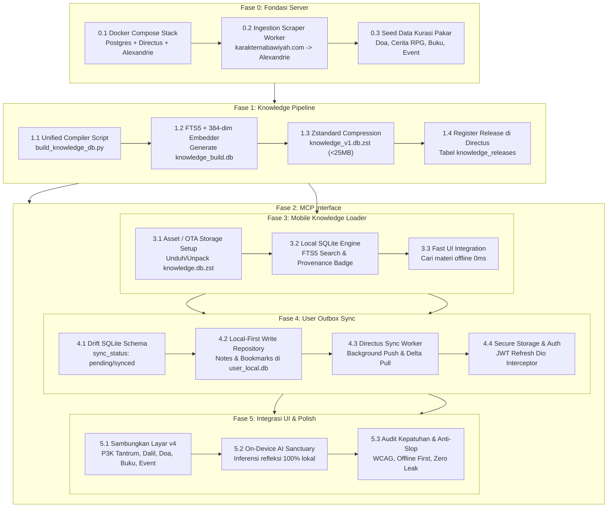

# Rencana Implementasi Prototipe Bertahap: Server-Side & Client-Side (Flutter)

> **Proyek:** PKN Healing Mobile App (Eksperimen Prototipe Terpadu)  
> **Arsitektur:** Dual-Database Engine, Directus Headless CMS, Alexandrie Hub, & Local-First Mobile  
> **Metode Pelaksanaan:** *Step-by-step Incremental Verification* (Tiap fase memiliki gate verifikasi konkret)

---

## 1. Peta Jalan & Garis Waktu Eksekusi (Roadmap)

---

## 2. Rincian Tahapan & Tugas Spesifik

### FASE 0: Persiapan Fondasi & Data Ingestion (Server-Side)
**Tujuan:** Memastikan infrastruktur server lokal aktif dan sumber data terisi secara terstruktur sebelum dikompilasi.

* **Tugas 0.1: Eksekusi Docker Compose Terpadu**
  * Jalankan stack `prototype/backend v2/compose.yaml`.
  * Verifikasi port: Directus (`8055`), Alexandrie (`8201`), PostgreSQL (`5432`).
  * Konfigurasi initial admin Directus dan periksa otomatisasi impor `schema.sql`.
* **Tugas 0.2: Implementasi Ingestion Worker (Event & Buku Scraper)**
  * Menjalankan script sinkronisasi dari `karakternabawiyah.com` (menggunakan pola `event_server.py` yang ada di `backend v1`).
  * Mentransformasi output JSON event dan daftar buku ke endpoint REST API Alexandrie (`POST /api/documents`).
* **Tugas 0.3: Kurasi Data Statis Alexandrie (Materi Non-AI Otoritatif)**
  * Input koleksi **Doa Penenang** (Hisnul Muslim, teks Arab berharakat, terjemahan, derajat hadits).
  * Input skenario **Cerita Adab Interaktif** (format graf keputusan JSON *Pintu Maghrib Zaid*).
  * Input data katalog **Pustaka PKN** (modul pengasuhan nabawiyah).
* **Kriteria Keberhasilan (Exit Gate):**
  * `http://localhost:8201/api/documents` mengembalikan dokumen kurasi pakar (doa, buku, event) secara konsisten.

---

### FASE 1: Unified Knowledge Compilation & OTA Pipeline (Server-Side)
**Tujuan:** Menggabungkan Markdown Wiki-AI dan Alexandrie menjadi satu berkas biner SQLite terkompresi Zstandard.

* **Tugas 1.1: Eksekusi Pipeline Kompilator `build_knowledge_db.py`**
  * Parameter: `--wiki-ai /home/abuhafi/Project/wiki-pkn` dan `--alexandrie-api http://localhost:8201/api`.
  * Chunking teks menjadi segmen 1.200 karakter dengan overlap 150 karakter.
  * Penyematan tag `provenance`: `'ai_assisted'` untuk Wiki-AI, `'expert_verified'` untuk Alexandrie.
* **Tugas 1.2: Pembuatan Indeks Pencarian & Vektor**
  * Bangun SQLite virtual table `articles_fts` (FTS5).
  * Generate vektor embedding 384-dim (`sentence-transformers/all-MiniLM-L6-v2`) untuk tabel `article_chunks`.
* **Tugas 1.3: Kompresi Zstandard & Checksum**
  * Kompresi `knowledge_build.db` $\rightarrow$ `knowledge_v1.db.zst` menggunakan level kompresi 19.
  * Hitung SHA-256 hash dan catat ukuran berkas mentah vs terkompresi.
* **Tugas 1.4: Pendaftaran Rilis OTA di Directus**
  * Simpan metadata ke tabel `knowledge_releases`: `version_code = 1`, `release_tag = 'v1.0.0'`, `sha256_checksum`, dan file payload.
* **Kriteria Keberhasilan (Exit Gate):**
  * Berkas `knowledge_v1.db.zst` berukuran $\le 25\text{ MB}$ terbentuk dan checksum-nya terverifikasi.

---

### FASE 2: Antarmuka Agen AI / MCP Server (Server-Side Tooling)
**Tujuan:** Menyediakan akses MCP langsung ke database biner tanpa menjalankan database terpisah.

* **Tugas 2.1: Scaffolding Script FastMCP**
  * Buat direktori `prototype/backend v2/mcp/` dan script `pkn_knowledge_mcp.py`.
  * Buka koneksi URI read-only: `sqlite3.connect("file:knowledge_build.db?mode=ro", uri=True)`.
* **Tugas 2.2: Implementasi 5 Tool Standar MCP**
  * `search_knowledge`: Hybrid search (FTS5 BM25 + Vektor 384-dim) dengan filter `provenance` & `content_type`.
  * `get_article`: Ambil teks lengkap artikel & metadata.
  * `get_doa_penenang`: Ambil doa terverifikasi pakar (Arab berharakat + sanad).
  * `get_skenario_adab`: Ambil pohon keputusan RPG & rubrik adab.
  * `get_agenda_event`: Ambil event daurah aktif.
* **Tugas 2.3: Uji Coba Integrasi Client MCP**
  * Daftarkan server di konfigurasi Cursor (`.cursor/mcp.json`) atau Claude Desktop.
* **Kriteria Keberhasilan (Exit Gate):**
  * AI Client dapat menjalankan tool `search_knowledge("thuma'ninah")` dan mendapatkan hasil yang akurat secara real-time.

---

### FASE 3: Knowledge Loader & Local Engine (Client-Side Flutter)
**Tujuan:** Aplikasi mobile mampu mengekstrak, mengindeks, dan mencari database pengetahuan secara luring.

* **Tugas 3.1: Pengelolaan Siklus Hidup Berkas `knowledge.db`**
  * Implementasikan `KnowledgeDatabaseService`:
    * First launch: Ekstrak pre-packaged `knowledge.db` dari aset, atau unduh paket `knowledge_v1.db.zst` dari Directus.
    * Simpan ke `getApplicationSupportDirectory() / knowledge.db` (dikecualikan dari iCloud/Android backup).
    * Lakukan verifikasi checksum SHA-256 sebelum membuka database.
* **Tugas 3.2: Local Search & Filtering Repository**
  * Query FTS5 SQLite langsung via pustaka `sqlite3` Dart.
  * Saring hasil berdasarkan `provenance` (`expert_verified` vs `ai_assisted`) dan `content_type`.
* **Tugas 3.3: Komponen Tampilan Kredibilitas di UI Flutter**
  * Widget lencana status:
    * 🟡 **Terverifikasi Pakar** (Doa, dalil, dan tulisan asatidz dari Alexandrie).
    * 🔵 **Eksplorasi AI** (Khazanah ensiklopedia dari Wiki-AI).
* **Kriteria Keberhasilan (Exit Gate):**
  * Pencarian kata kunci di search bar Flutter merespons dalam $< 15\text{ ms}$ saat mode pesawat (luring total).

---

### FASE 4: Drift Outbox Sync & User Session (Client-Side + Directus)
**Tujuan:** Menyediakan penyimpanan personal pengguna (catatan & bookmark) yang local-first dan sinkron otomatis.

* **Tugas 4.1: Skema Drift Lokal (`user_local.db`)**
  * Buat tabel `UserNotesTable` dan `UserBookmarksTable` dengan kolom `sync_status` (`'pending'`, `'synced'`, `'deleted'`).
* **Tugas 4.2: Pola Local-First Repository**
  * Operasi simpan, edit, dan hapus langsung menulis ke Drift lokal ($0\text{ ms}$ delay).
  * Stream UI langsung menampilkan perubahan tanpa menunggu status jaringan.
* **Tugas 4.3: Directus Outbox Sync Worker**
  * Listener konektivitas (`connectivity_plus`) & event `AppLifecycleState.resumed`:
    * **Push:** Kirim seluruh record dengan status `'pending'` ke Directus API (`POST /items/user_notes`).
    * **Pull:** Ambil catatan yang diperbarui di server sejak `last_synced_at`.
* **Tugas 4.4: Manajemen Token Aman**
  * Integrasi `flutter_secure_storage` untuk menyimpan JWT access token dan refresh token.
  * Dio HTTP Interceptor untuk otomatis me-refresh token saat menerima status 401.
* **Kriteria Keberhasilan (Exit Gate):**
  * Catatan yang dibuat saat perangkat offline berhasil terunggah ke Directus begitu koneksi internet aktif kembali.

---

### FASE 5: Integrasi UI Earth-Tree & Polish Alur Pengguna (Client-Side)
**Tujuan:** Menghubungkan seluruh modul tampilan pada `prototype/v4` dengan data nyata multi-sumber.

* **Tugas 5.1: Koneksi Seksi-Seksi Beranda ke Data Riil**
  * **Seksi P3K Tantrum & Dalil:** Membaca SOP darurat dari `knowledge.db` (tipe `article` / `expert_verified`).
  * **Seksi Doa Penenang:** Membaca doa dari Alexandrie (Arab berharakat + audio visualizer).
  * **Seksi Cerita & Skenario:** Mengikat PageView interaktif ke data skenario RPG nyata.
  * **Seksi Pustaka Buku & Agenda:** Membaca katalog buku dan jadwal daurah.
* **Tugas 5.2: AI Sanctuary On-Device (Zero Cloud Leak)**
  * Hubungkan inferensi pencarian rekomendasi ke embedder lokal ONNX tanpa API eksternal.
  * Pastikan buffer curhat/suara dihapus segera setelah sesi refleksi selesai.
* **Tugas 5.3: Pengujian Fungsional & Anti-Slop Audit**
  * Jalankan pengujian kontras warna WCAG tema Earth-Tree (Light & Dark).
  * Uji skalabilitas teks dinamis (aksesibilitas).
* **Kriteria Keberhasilan (Exit Gate):**
  * Seluruh alur utama (A–E) di `prototype/v4` beroperasi menggunakan data riil, bebas error overflow, dan patuh manhaj luring.

---

## 3. Matriks Ketergantungan Antar Fase

| Fase | Prasyarat (Dependencies) | Output Utama |
|---|---|---|
| **Fase 0** | Docker Engine, Repositori `wiki-pkn` | Stack Server Aktif, API Alexandrie Berisi Data |
| **Fase 1** | Fase 0 Selesai | Berkas `knowledge_v1.db.zst` di Directus |
| **Fase 2** | Fase 1 Selesai (`knowledge_build.db` ada) | Script MCP Server & Integrasi Tooling AI |
| **Fase 3** | Fase 1 Selesai | Service Pembaca SQLite Luring di Flutter |
| **Fase 4** | Fase 0 & 3 Selesai | Sinkronisasi Drift Outbox ke Directus Berfungsi |
| **Fase 5** | Fase 3 & 4 Selesai | Prototipe Aplikasi Mobile Lengkap & Teruji |

## 4. Gate Prototipe Backend Ringan

Implementasi kemampuan backend dapat diverifikasi tanpa UI maupun stack Docker melalui `python3 test_backend_v2.py`. Gate mencakup ingestion WordPress, perubahan snapshot kurasi, kompilasi SQLite/FTS5, checksum dan ekstraksi Zstandard, distribusi OTA HTTP, sinkronisasi outbox lintas perangkat, serta lima tool MCP melalui stdio. `user_sync.db` tidak digabungkan ke knowledge. Integrasi Directus/OAuth dan klien Flutter pada roadmap di atas tidak dinyatakan terverifikasi oleh pengujian ini.

Kontrak Alexandrie yang ditemukan pada implementasi sebelumnya menggunakan `/api/nodes` (dokumen `role=3`), bukan `/api/documents`. Snapshot JSON kurasi menjadi sumber lokal yang dapat dijalankan tanpa kredensial CMS; akses API memerlukan URL dan kredensial nyata.

