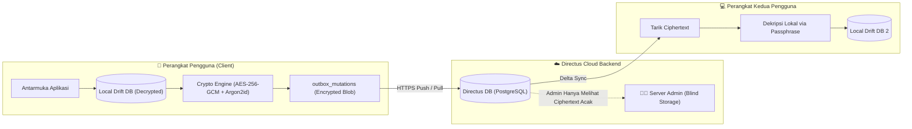

# Dokumen Audit Sistem, Evaluasi Kritis & Keputusan Arsitektural PKN Mobile v2

> **Status:** Dokumen Keputusan Arsitektur & Rekayasa Sistem (*Architecture Decision Record - ADR*)  
> **Metodologi Evaluasi:** Analisis Multi-Perspektif menggunakan engine **Oh My Pi (OMP v18.8.0)** dengan skill *Quality Auditor*, *System Diagnostician*, *Security Architect*, dan *UI/UX Pro Max / Calm Technology Designer*.  
> **Berkas yang Diaudit:** Cetak Biru di `prototype/compile v2/` (`README.md`, `MODULAR_MODULES_DECOMPOSITION.md`, `DATABASE_AND_BACKEND_SCHEMA.md`, `PHASED_IMPLEMENTATION_ROADMAP.md`).

---

## 1. Ringkasan Eksekutif Hasil Audit

Audit teknis komprehensif terhadap dokumen cetak biru PKN Mobile v2 menghasilkan kesimpulan inti:
1. **Arah Desain Kuat, Kontrak Belum Tuntas:** Pemisahan database personal dan publik serta pembagian UI modular adalah langkah awal yang sangat baik. Namun, cetak biru awal baru mendefinisikan *Surface UI* (lapisan presentasi), belum menjadi spesifikasi teknis *end-to-end* dengan kontrak data, jaminan keamanan runtime, dan *lifecycle* yang kokoh.
2. **Klarifikasi Peran Backend Directus:** Directus ditetapkan secara tegas sebagai **Headless CMS untuk konten publik** sekaligus **Cloud Identity & Data Sync Engine untuk multi-perangkat**.
3. **Penerapan Zero-Knowledge E2EE:** Seluruh data personal (profil, relasi keluarga, amalan adab, transkrip curhat) dienkripsi di sisi klien (*Client-Side End-to-End Encryption*) menggunakan **AES-256-GCM** sebelum disimpan di server Directus. Server hanya menjadi brankas buta (*blind storage*), menjamin kerahasiaan aib keluarga (*satrul 'aurat*) 100%.

---

## 2. Bagian I: Pembahasan Audit 1 — Arsitektur Data, Modularitas & Roadmap

### 2.1 Evaluasi Dual-Database & Penegasan Peran Directus

#### Temuan Audit:
- Cetak biru awal memisahkan `local_userdata.db` (Drift SQLite) dan `knowledge_v4.db` (LibSQL Vector), namun mengambangkan jalur sinkronisasi personal: siapa pemilik endpoint `POST /api/sync/v2/outbox`?
- Ada risiko ambiguitas apakah Directus hanya CMS publik atau juga menyimpan akun pengguna.

#### Keputusan Arsitektur:
- **Directus sebagai Pusat Sinkronisasi Multi-Perangkat:** Directus secara resmi menjadi backend cloud untuk otentikasi akun dan sinkronisasi data personal pengguna lintas perangkat (Android, iOS, Web).
- **Offline-First via Drift:** SQLite lokal (Drift) tetap menjadi *primary local source of truth*. Aplikasi membaca dan menulis data secara instan di perangkat tanpa ketergantungan koneksi internet.
- **LibSQL OTA Bundle:** Tetap digunakan untuk khazanah publik berukuran ~7 MB (FTS5 + Vector Embeddings) yang diunduh secara berkala.

---

### 2.2 Arsitektur End-to-End Encryption (E2EE) pada Directus

Untuk memastikan data pengguna (termasuk nama anak, masalah adab, dan catatan muhasabah) tidak dapat dilihat oleh siapa pun—termasuk developer, admin server Directus, maupun penyedia hosting:



#### Spesifikasi Kriptografi E2EE:
1. **Key Derivation (Klien):**
   - Menggunakan **Argon2id** (atau PBKDF2-SHA256, 600.000 iterasi) untuk menurunkan master key dari kata sandi / *passphrase* pengguna.
   - Menghasilkan dua kunci:
     - `AuthKey`: Dikirim ke Directus hanya untuk keperluan verifikasi login akun.
     - `DataEncryptionKey` (AES-256): Disimpan rapat di brankas perangkat keras HP (*Android Keystore / iOS Keychain*), **TIDAK PERNAH dikirim ke server**.
2. **Encrypted Envelope Format di Directus:**
   - Kolom metadata operasional tetap terbuka: `id` (UUID), `user_id` (UUID), `updated_at` (Timestamp), `deleted_at` (Timestamp untuk tombstone).
   - Kolom konten tersimpan sebagai `encrypted_payload`:
     ```json
     {
       "id": "rel_c71a82d0-...",
       "user_id": "usr_99b1-...",
       "updated_at": "2026-10-13T12:00:00Z",
       "deleted_at": null,
       "encrypted_payload": {
         "iv": "d13f89a4e21...",
         "ciphertext": "8xA9zK2pL...[HANYA STRING ACAK]...",
         "tag": "f901ab3..."
       }
     }
     ```
3. **Kunci Pemulihan Darurat (*12-Word Recovery Phrase*):**
   - Diberikan 12 kata pemulihan standar BIP-39 saat registrasi pertama untuk pemulihan akun jika pengguna lupa kata sandi.

---

### 2.3 Kebijakan Privasi Khusus Fitur Curhat AI (Ruang Qalbu)

#### Temuan Audit:
- Suara audio berukuran besar membebani penyimpanan lokal/cloud.
- Data keluh kesah dan curahan hati batin adalah data berisiko tinggi terhadap kebocoran aib dan kerentanan psikologis.

#### Keputusan Arsitektur:
1. **Audio Rekaman Suara PTT ➔ Ephemeral (Segera Dihancurkan):**
   - Rekaman audio pengguna diproses oleh mesin *Speech-to-Text* (STT) di memori sementara.
   - **File suara (.m4a/.wav) langsung dihapus permanen dari memori/disk begitu teks transkrip dihasilkan.** File suara **TIDAK PERNAH** disimpan di database lokal maupun server.
2. **Transkrip Chat (Teks) ➔ Disimpan Terenkripsi E2EE:**
   - Transkrip teks percakapan disimpan di database Drift lokal agar pengguna dapat membacanya secara offline.
   - Transkrip teks disinkronkan ke Directus **dalam kondisi terenkripsi E2EE (AES-256-GCM)** sehingga aman saat pengguna berganti perangkat.
   - Admin server Directus tidak dapat membaca percakapan curhat pengguna.
3. **Kendali Pengguna Penuh:**
   - Pengguna memiliki tombol *"Hapus Sesi Curhat Ini"* yang menghapus data secara permanen dari perangkat lokal dan server.
   - Disediakan toggle pengaturan privasi: `Cadangkan riwayat curhat antar-perangkat (E2EE)`.

---

### 2.4 Penyelesaian Konflik Skip Onboarding vs Skema User (Guest Identity)

#### Temuan Audit:
- Pengguna diizinkan menekan tombol *"Akses Langsung Tools Tafsir Bakat 40"* di Onboarding (Modul 10).
- Namun tabel `users` mewajibkan kolom `name` dan `role` (`NOT NULL`), dan tabel asesmen TB-40 mewajibkan `user_id`. Ini memicu crash atau pemaksaan data fiktif.

#### Keputusan Arsitektur:
- **Pola Guest Identity Otomatis:**
  - Saat aplikasi pertama kali dipasang, sistem otomatis menginisialisasi entitas profil lokal dengan status tamu:
    ```sql
    INSERT INTO users (id, name, role, is_guest, created_at)
    VALUES ('local_guest_uuid', 'Tamu', 'Tamu', 1, CURRENT_TIMESTAMP);
    ```
  - Asesmen TB-40 langsung mengikat ke `local_guest_uuid` tersebut.
  - Saat pengguna nantinya menyelesaikan Onboarding atau mendaftarkan akun di kemudian hari, profil tersebut dilakukan **`UPSERT` (diperbarui di tempat)** tanpa menghapus hasil tes TB-40 yang telah dilakukan sebelumnya.

---

### 2.5 Dekomposisi 12 Modul: Pemisahan Surface vs Domain Boundaries

#### Temuan Audit:
- 6 surface visual (Bento, Carousel, Collapsible, Action Tiles, Avatar Strip, Header Ticker) adalah ragam tampilan presentasi, bukan batas modularitas domain.
- Jika Beranda dan Profil mengimpor *state* dan *business logic* dari seluruh modul, kedua layar tersebut akan menjadi *God-Screen* dengan *tight coupling*.

#### Keputusan Arsitektur:
- **Homescreen & Profile sebagai Composition Layer Murni:**
  - Halaman Beranda dan Profil dilarang mengeksekusi mutasi domain secara langsung.
  - Beranda hanya berlangganan pada *Read-Only Projections* yang diekspos oleh masing-masing *Domain Repository*.
- **Penyelarasan DDL yang Hilang:**
  - Menambahkan DDL tabel Drift lokal untuk:
    1. `user_event_badges`: Menyimpan status lencana dan sertifikat daurah yang diikuti.
    2. `user_bookmarks`: Menyimpan artikel wiki yang disimpan secara offline.
    3. `kemitraan_submissions`: Menyimpan draf dan riwayat pengajuan kerjasama lembaga.
    4. `story_progress`: Menyimpan bab dan pilihan latihan adab yang telah diselesaikan.

---

### 2.6 Penataan Ulang Roadmap 4 Fase (Pencegahan Mock / Double Work)

#### Temuan Audit:
- Menempatkan setup database Drift di Fase 3 berisiko membuat seluruh antarmuka yang dibangun di Fase 1 dan 2 menggunakan data tiruan (*mock data*) yang harus dirombak ulang secara drastis saat database masuk.

#### Revisi Roadmap Eksekusi:
```
┌────────────────────────────────────────────────────────────────────────┐
│              ROADMAP REVISI HASIL AUDIT (PKN MOBILE V2)                │
├─────────────────┬─────────────────┬─────────────────┬──────────────────┤
│     FASE 1      │     FASE 2      │     FASE 3      │      FASE 4      │
│  Data Foundation│  Identitas &    │  Instrumen      │  Pendampingan    │
│  & Publik Core  │  Khazanah Ilmu  │  Personal E2EE  │  Batin & Rilis   │
├─────────────────┼─────────────────┼─────────────────┼──────────────────┤
│ • Setup Flutter │ • Guest Identity│ • Modul 7:      │ • Modul 11:      │
│ • Drift SQLite  │   & Profil User │   Tafsir Bakat  │   Curhat AI      │
│   (Local DB)    │ • Modul 6: Wiki │   (Guest Flow)  │   (STT/LLM Local)│
│ • LibSQL Engine │   (FTS5 + Audio)│ • Modul 8:      │ • Ephemeral Audio│
│ • Directus Sync │ • Bookmarks &   │   Ceklist Harian│ • Modul 12:      │
│   Client (E2EE) │   Riwayat Baca  │ • Modul 9:      │   Cerita         │
│ • Shell 5 Tab   │ • Sync Engine   │   Relasi E2EE   │   Interaktif     │
│ • Modul 1: Event│   Directus Klien│ • Modul 10:     │ • Audit Rilis    │
│ • Modul 2: Buku │                 │   Onboarding    │   Keamanan &     │
│ • Modul 3: Tokoh│                 │   Idempotent    │   Aksesibilitas  │
│ • Modul 4: Mitra│                 │                 │                  │
└─────────────────┴─────────────────┴─────────────────┴──────────────────┘
```

---

## 3. Matriks Perubahan & Verifikasi Audit 1

| Area | Sebelum Audit | Sesudah Keputusan Audit |
| :--- | :--- | :--- |
| **Penyimpanan Cloud** | Tidak jelas / potensi data tersimpan mentah | **Directus Blind Storage:** Klien E2EE (AES-256-GCM), server hanya menerima ciphertext. |
| **Suara Curhat AI** | Tidak ada kebijakan penghancuran | **Ephemeral:** File audio dihapus permanen seketika setelah transkripsi teks selesai. |
| **Transkrip Curhat** | Bersifat lokal tanpa sinkronisasi | **Disimpan di DB lokal & Directus E2EE:** Multi-perangkat tetap aman dan privat. |
| **Akses Langsung TB-40** | Rentan crash karena `users` NOT NULL | **Guest Identity:** Terinisialisasi otomatis, di-*upsert* saat registrasi formal. |
| **Komposisi Beranda** | Berpotensi menjadi God-Screen | **Composition Layer:** Beranda hanya membaca proyeksi read-only repository. |
| **Urutan Roadmap** | Drift baru dibuat di Fase 3 | **Fondasi Data di Fase 1:** Drift, LibSQL, dan Directus client dibangun di sprint awal. |

---

*(Bagian II mengenai Audit 2: Keamanan, Aksesibilitas WCAG 2.2, dan Calm Technology UX akan dibahas dan didokumentasikan pada langkah berikutnya).*
